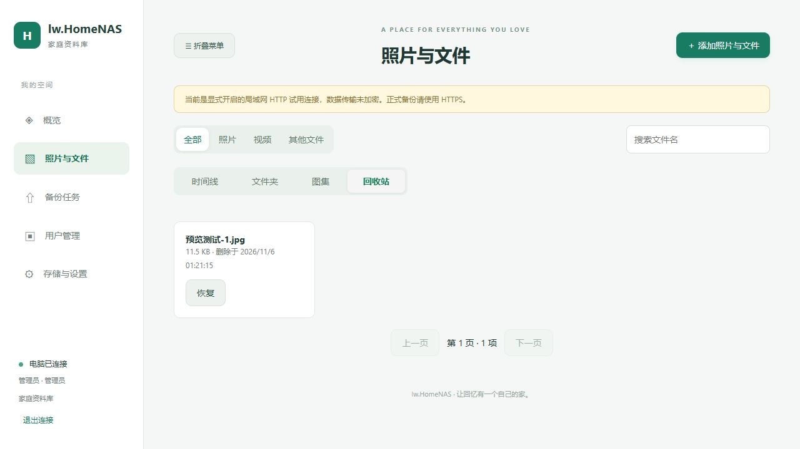

# lw.HomeNAS

自己的电脑做服务器，手机照片和视频备份到家里。

lw.HomeNAS 使用 **C++17 + cpp-httplib** 开发 Windows 后台，提供浏览器管理页面和 Android 客户端。除了照片、视频，也支持文档、录音及其他文件。当前版本源代码为 **1.2.0**，目标平台为 Windows 10/11 x64 和 Android 10 及以上。

**v1.2.0 已发布**：Web上传可选择/新建目标文件夹，完整包内置APK，服务启动自动发布，手机在登录页即可下载。已发布APK为code21/nativeApi12。[更新与升级说明](docs/20261112-v1.2.0发布说明.md)。

**下一轮开发（code22/nativeApi13，待CI）**：手机备份中心显示最近运行/扫描记录、暂停与等待条件、失败入口，并明确统计范围。APK下载名简化为 `HomeNAS-1.2.0.apk`，调试版为 `HomeNAS-1.2.0-debug.apk`，固定签名和软件内构建信息保留。版本名称暂沿用1.2.0，本轮先生成测试产物，不覆盖已有公开Release。[设计与验证](docs/20261113-备份中心与APK短文件名.md)。

本轮优化：资料库跨页选择保留勾选，显示“本页 / 其他页”数量，支持查看并取消其他页选择；移动自动核对共同来源，部分失败保留未完成项，删空末页后正确回退。手机新目录选图不再被其他目录的待上传记录误跳过，上传进度显示各任务实际目标。[使用与验证记录](docs/20261107-跨页整理与手机目标目录修复.md)。

Web上传支持选择保存文件夹：点击“添加照片与文件”进入备份任务，在“保存到”选择已有文件夹或新建，再选择文件/本地文件夹或拖入文件。不选时进入默认文件夹。目标在加入队列时固定，切换只影响新文件；同一文件可备份到不同文件夹并复用原件。任务和历史记录显示实际目标。[操作与验证](docs/20261108-Web上传目标文件夹.md)。

[下载发布包](https://github.com/lxw112190/lw.HomeNAS/releases) · [构建与 APK](https://github.com/lxw112190/lw.HomeNAS/actions) · [部署脚本](deploy/README.md) · [接口说明](docs/API.md) · [v1.0 更新说明](docs/20261106-v1.0发布说明.md)

## 可以做什么

- **手机备份**：按天选照片/视频，整天全选后排除单张，标记已备份项目；支持选择相册、目标文件夹和系统调度的定时备份。
- **大文件上传**：分块上传、确认偏移持久化、暂停/继续、失败重试、SHA256 完整校验和同内容去重。文件大小与偏移按64位处理。
- **整理资料**：按文件时间浏览时间线，或按文件夹、图集浏览，均支持分页。重命名保留扩展名，图片可在文件夹之间移动。
- **回收站**：Web支持单项或批量移入回收站、分页浏览和恢复；保留原件及目录/图集关联。回收站不会自动清空，**移入回收站不释放磁盘空间**，手机自动备份不会将其悄悄恢复。
- **预览**：Web/APK图片缩放、拖动、原始大小和上一张/下一张；元数据默认折叠，展开后读取文件及可用的EXIF信息。视频支持封面与浏览器/手机可解码格式的在线播放。
- **多账号**：admin/member/viewer 三种角色。管理员管理全部内容，普通用户管理自己上传的文件和自己创建的分类，只读用户浏览下载。
- **部署维护**：Windows服务、开机启动、异常恢复、HTTP/HTTPS、7个BAT入口、独立安装日志、运行日志、手机日志轮转和诊断ZIP。
- **客户端维护**：固定签名APK覆盖升级与已签名网页资源更新；原生功能变化需要升级APK。

**资料库目前共享浏览，文件夹是逻辑分类，不是每个用户独立的私有空间。** 同一原件可被多个目录或图集引用，移动只改变指定目录关联。



## 五分钟开始使用

1. 下载并完整解压Windows发布ZIP，保持 `NasServer.exe`、`web`、`config`、`deploy` 等目录结构。
2. 首次可双击根目录 `启动服务.cmd` 前台运行，浏览器打开 `http://127.0.0.1:8787/`。运行期间保持窗口打开。
3. 发布包全新资料库默认 **admin / admin123**，登录后修改密码；已有账号不会被覆盖。源码默认配置使用随机初始密码，见控制台或 `data/initial-admin-password.txt`。
4. 完整发布包的 `client-release` 文件夹包含APK及版本清单。启动NAS后自动校验并发布，手机打开网页登录页即可下载，无需先登录，也无需执行导入命令。可选的签名页面资源同时自动发布；后续仍可在Web设置页发布APK。较旧包不会覆盖已发布新版，管理员撤下后重启不会重新上架同版。[完整包说明](docs/20261112-完整包启动自动发布APK.md)。

5. 手机填写电脑IP和端口、登录账号，选择文件/相册和备份目标，再开始备份。手机与电脑先在可互访的家庭局域网使用。

### 安装为 Windows 服务

先退出前台NAS，再右键 `deploy/install-service.bat`，选择“以管理员身份运行”。安装后自动启动，并设置开机启动。只保留以下7个BAT：

| 文件 | 用途 |
| --- | --- |
| install-service.bat | 按配置安装并启动 |
| start-service.bat | 启动 |
| stop-service.bat | 停止 |
| restart-service.bat | 重启 |
| uninstall-service.bat | 卸载服务，保留数据 |
| open_firewall.bat | 开放配置端口对应的受管规则 |
| remove_firewall.bat | 删除本工具的受管规则 |

不覆盖已存在的同名服务。安装失败看 `deploy/logs/service-install.log`，程序启动后的错误看 `data/logs/service.log`。更多命令、1783诊断与权限处理见[部署说明](deploy/README.md)。

### 地址、端口与相对路径

配置位于EXE旁 `config/server.json`。路径相对于**配置文件目录**解析，不依赖启动时所在目录：

```json
{
  "data_dir": "../data",
  "web_dir": "../web",
  "ffmpeg_path": "../tools/ffmpeg/ffmpeg.exe",
  "http_port": 8787,
  "https_port": 9443,
  "allow_insecure_lan": true
}
```

以上仅为配置片段，修改发布包现有配置中的相应字段即可。改端口后重启服务，防火墙规则按新配置重新开放。服务模式和前台模式共用配置。

局域网HTTP按使用要求默认开启；发布包 `allow_external_hosts` 也默认true。HTTP传输不加密，公网部署需自行配置HTTPS、访问范围和云安全组。HTTPS自签名证书需核对并信任，不能关闭证书验证。

## 文件操作

- **批量照片**：在Web时间线或图集/文件夹内点“选择文件”，可跨页选择、移入回收站、移动到文件夹或导出一个ZIP。时间线的“全选这一天”会读取当天后续分页，不仅选择当前可见的照片。每次最多1000项，写操作按100项分批执行并报告已完成数量。
- **批量回收站**：图片有缩略图，可放大查看；选择多项后可批量恢复。管理员批量彻底删除时仍需输入“彻底删除”确认。中途失败保留未完成项，不把整个批次显示为成功。
- **APK大批量选图**：全选已授权范围、按月/按天选择，支持取消月份、日期和单张；照片/视频可筛选，已备份和已入队状态可见。日期按文件修改时间分组。
- **分页加入队列**：整月和全选不再受旧的5000项总量限制，原生端每页100项核实并入队，显示进度，可停止后重试，已加入任务保留。显式勾选/排除单张仍各限5000项。
- **并发上传**：默认同时上传2项，可选1/2/3项，下次开始备份生效；各文件独立续传，总速度、剩余大小和各文件阶段分开展示。新能力需要安装code19或更新APK，实际手机速度仍需测量。[使用与验证](docs/20261106-APK整月选择与并发备份.md)。
- **图集交互**：添加绿色、编辑/移动蓝色、移出橙色、删除红色、导出紫色。进入图集的“添加照片 / 视频”后，已有成员标记“已添加”并排除重复选择；Web/APK均支持按天跨页选择。需配套1.0.2电脑端。
- **导出**：ZIP以流式方式直接下载，不在JavaScript内存中拼接整包，也不先在服务器生成临时压缩包。重名文件增加序号，文件内容保持不变；导出窗口中请按浏览器提示保存。

- **移动**：打开图片预览，点“移动文件夹”，选择目标；文件属于多个目录时可选择来源。也可进入文件夹，选择多项后批量移动。目标目录需有写入权限，原件不会在磁盘上重新复制。
- **删除/恢复**：图片预览中点“移入回收站”，或在资料库选择多项后删除。普通用户仅能删除自己上传过的文件、恢复自己删除的文件。管理员可在Web回收站单个“彻底删除”，需输入“彻底删除”确认；成功后原件、缩略图及分类关联永久清除，所有成员均不可恢复。若显示“继续清理”，请解除占用后重试。手机本地文件保留，再次备份可能重新上传。
- **预览**：上一张/下一张作用于当前已加载的一页。Web可用左右方向键，图片可滚轮/双指缩放；“文件与拍摄信息”按需展开。缺失EXIF不推测。
- **音视频**：APK 1.0.1起，打开文件预览后点“播放视频/播放音频”，进入应用内原生播放器，可暂停、拖动进度和返回。使用手机解码能力，绕过WebView对HEVC等格式的播放限制；是否支持仍取决于设备，不保证所有编码。旧资料库中归类为“文件”的MP3也能识别。Web仍由浏览器播放；FFmpeg仅生成视频封面，不自动转码原件。

手机删除本地文件不会删除电脑原件。回收站是恢复机制，不能代替独立备份；重要内容建议另存第二份。

## 从旧版更新

1. 停止服务，备份原 `config` 和 `data`。
2. 替换EXE、web、deploy及工具文件，保留原配置和资料库。
3. 新版自动补充数据库表，保留原件、账号、目录及上传进度。移动安装位置时，先在旧位置卸载服务，再在新位置安装。
4. Android v1.2.0 的 versionCode 为21，继续使用仓库既有签名，原生协议保持12。升级后使用当前内置页面，旧签名资源不会遮住目录修复及新交互。手机原生修复需要安装新 APK，Android 完整编译和真机验证由 CI 与后续测试完成。不要用旧程序回开已经升级的资料库。

## 编译源码

Windows安装VS2022的“使用C++的桌面开发”和Windows SDK，使用 `lw.HomeNAS.sln` 的 Release/x64，或使用CMake入口：

```powershell
powershell -NoProfile -ExecutionPolicy Bypass -File tools/build.ps1
python tools/check-version.py
python tests/smoke.py --exe build/app/Release/NasServer.exe
python tests/recycle.py
```

SQLite、Mbed TLS、cpp-httplib等依赖已锁定；不要随意改变文件换行或跳过哈希校验。Android源码位于 `android`，使用Java及本地可信WebView页面，构建说明见[Android README](android/README.md)。本项目通过CI编译APK，不要求Windows后台运行Python、.NET或Android SDK。

## CI与正式发布

- 推送 `main`：在 **Build APK, server and Release** 中并行执行APK构建（固定签名Debug/Release、Lint/JVM）与Windows后台编译/回归；模拟器接续APK任务，全部通过后汇合生成完整ZIP。后台只编译一次，最终打包复用同一提交、同一CI编号的已测试EXE和FFmpeg。
- Actions产物：`lw.HomeNAS-Android-N` 是APK；`lw.HomeNAS-server-ciN` 是不含APK的独立后台包；**`lw.HomeNAS-full-ciN` 是日常部署推荐的完整包**，内含后台、APK及校验清单。任一构建分支成功即可下载该分支产物，但完整包必须等待两边构建和模拟器全部通过。
- 工作流入口继续使用 [android.yml](.github/workflows/android.yml)，延续原CI编号；旧串行 `release.yml` 已合并，避免重复触发和混用历史APK。
- **版本未发布**：读取该提交的 `VERSION`，如 `1.0.0`，全部检查通过后自动创建并公开正式 `v1.0.0` Release；带预发布后缀的版本标记为prerelease。
- **版本已发布**：继续生成Actions中的完整包与APK，保留原有Release和标签，不重复发布、不覆盖旧附件。
- 在main手动运行时，关闭 `publish` 可仅构建完整包；关闭 `emulator` 则只生成APK和后台独立产物，跳过完整包与Release。PR执行编译和检查，不分发签名APK、不发布。失败草稿不会当作正式版发布。
- 失败后可在同一次运行中重跑失败任务；已成功分支的产物会被复用，产物过期时需重跑全部任务。验证细节见[并行CI说明](docs/20261113-APK与后台并行CI.md)。
- 升版时同步 `VERSION`、`src/core.hpp`、`CMakeLists.txt`、Android versionName；修改APK原生/内置功能时递增versionCode。CI会检查版本一致性。

仓库Secrets继续使用 `ANDROID_KEYSTORE_BASE64`、`ANDROID_KEYSTORE_PASSWORD`、`ANDROID_KEY_ALIAS`、`ANDROID_KEY_PASSWORD`。`UI_SIGNING_KEY_BASE64` 可选，未配置时完整包使用APK内置页面。密钥、数据、真实日志和签名私钥不提交Git。

## 验证范围与限制

每轮Windows测试使用独立合成数据，验证分块恢复、去重、权限、分类、回收站及原件一致性。Android编译/JVM/模拟器通过情况以对应CI为准，语法或页面检查不等于真机通过。Windows服务实际兼容以目标机实测为准；本次Win10教育版的1783故障在系统文件修复并重启后，用户已反馈安装成功。

当前不包含iOS客户端、RAID、端到端加密、每用户私有空间或全格式视频转码。Android后台备份受系统调度、省电策略、网络和权限限制；网页上传需保持页面打开。

## 项目与许可

Android方案参考 [lw.Web2Android](https://github.com/lxw112190/lw.Web2Android)，部署脚本参考 [lw.PPOCR.OpenCVDNN](https://github.com/lxw112190/lw.PPOCR.OpenCVDNN)。项目许可见[LICENSE](LICENSE)，第三方组件和FFmpeg许可、来源及源码归档见[THIRD-PARTY-NOTICES.md](THIRD-PARTY-NOTICES.md)与包内licenses/tools目录。

## 联系与支持

- 作者：天天代码码天天
- QQ：819069052
- QQ Group: 天天代码码天天 | 群号: 264292622

如果项目对你有帮助，可以扫码支持维护：


