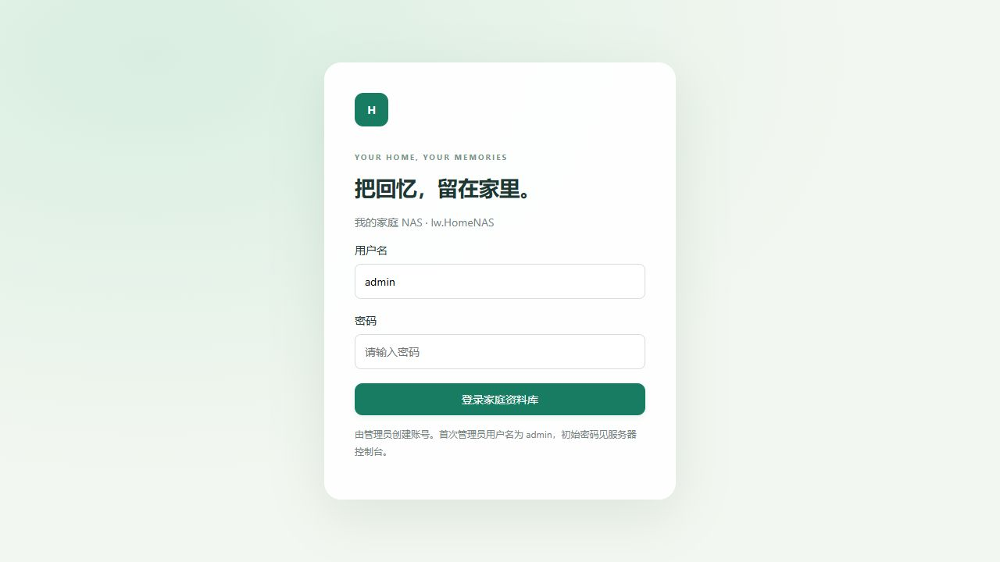
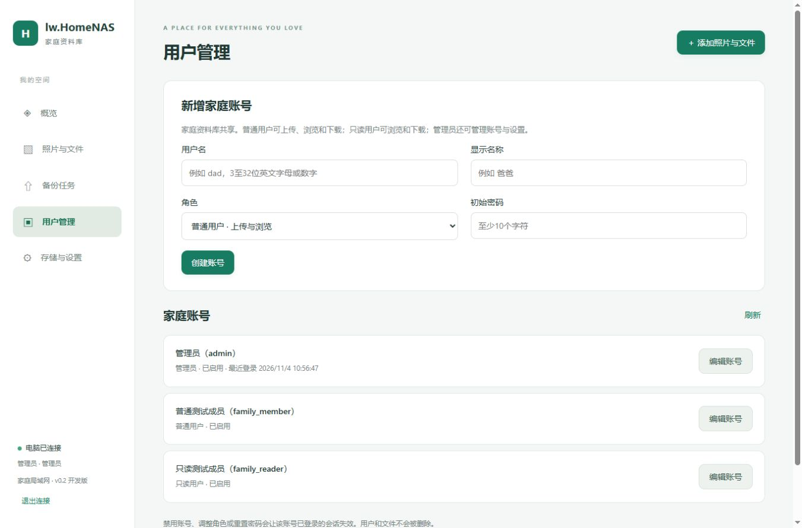

# lw.HomeNAS

轻量家庭 NAS，使用 C++17 / cpp-httplib 提供服务，通过 Web 管理与浏览自己的照片、视频、文档和录音。项目主页：[lxw112190/lw.HomeNAS](https://github.com/lxw112190/lw.HomeNAS)。

电脑服务源码当前为 **0.3.0-dev**，Android 源码为 **0.6.0-dev / versionCode 7 / nativeApi 3**。新增两端时间线、安卓图片/视频预览、按天选图及服务器核对备份状态，详见[本轮功能与验证](docs/20261104-时间线与按天选图.md)。本机不安装 Android SDK，新 APK 等待用户提交到 CI 编译；收到 APK 后再制作部署包。已分发的旧包仍为 CI5 0.5.0-dev / code6 与简约资源 r4，不代表新原生功能已发布。





新增APK网页下载/发布、签名资源更新、诊断日志上传与防火墙批处理，详见[客户端维护使用说明](docs/20261104-客户端更新与日志反馈.md)。新版APK需先通过CI编译安装，才能使用原生维护功能。

已收到Android CI5的0.5.0-dev Debug APK，含APK部署包可用导入脚本发布网页下载。该APK的Debug签名与CI3不同，不能直接覆盖旧版；请先阅读[升级与数据说明](docs/20261104-CI5安卓安装包发布.md)。

## 已实现

- 本机 HTTP 管理口与局域网 HTTPS，首次生成独立服务器证书。
- 用户名/密码登录、管理员创建账号、角色调整、禁用账号、重置密码与本人修改密码。
- 共享家庭资料库，支持管理员/普通用户/只读用户；上传任务按账号归属，暂不提供个人文件隔离。
- 多文件前台上传、Web Worker 分段 SHA256、服务端流式写盘、有界并发。
- 上传会话持久化、重选文件续传、块摘要及整文件校验、完整校验后台执行。
- 临时文件尾部回退与 COMMITTING 中间状态恢复；原件丢失不会误报去重成功。
- 精确内容去重、同名不同文件分别保留、文件名搜索与游标分页。
- Web / Android 按文件时间或入库时间分组展示；Android 按天选图、服务器核实已备份状态、照片和视频预览及紧凑保存按钮（需新 APK）。
- Windows WIC 图片缩略图与8种 EXIF方向处理；原件下载、视频/音频的浏览器原生播放与单段 Range 读取。
- 手机删除或禁用账号不删除电脑原件，本版没有自动删除原件的功能。

HEIC/RAW等文件可以按原件保存，预览由本机WIC/浏览器实际支持决定；本版未做视频封面或兼容转码。超过4GiB长度的协议字段已检查，但完整超4GiB上传仍需后续真机测试。

旧版Windows CMD中文输出修复及验证范围见[控制台兼容记录](docs/20261104-控制台中文输出兼容.md)。

## 编译与运行

Windows 10/11 x64，安装 VS2022 的“使用 C++ 的桌面开发”和 Windows SDK。

1. 打开根目录 `lw.HomeNAS.sln`，选择 `Release | x64`，生成解决方案。
2. 运行根目录 `Run.cmd`，或直接运行 `out/Release/NasServer.exe`。
3. 电脑打开 `http://127.0.0.1:8787/`。
4. 用户名为 `admin`。默认首次随机密码见控制台及该运行目录的 `data/initial-admin-password.txt`。测试时可以先关闭前台程序、停止服务，再运行 `deploy/set_admin_password.bat` 输入自己的密码（至少6位，无需大小写/符号组合），然后启动服务；也可在首次启动前设置。自选密码不写入初始密码文件。

依赖源码已包含，直接打开 VS 方案编译不需要 Python、CMake、NuGet 或在线下载。首次运行会创建数据目录和证书，源码默认配置使用首次随机密码。下一次部署包按用户要求默认 admin / admin123，登录后修改；已有账号不会重置。

也可使用 CMake 3.24+：

```powershell
powershell -NoProfile -ExecutionPolicy Bypass -File tools/build.ps1
.\build\app\Release\NasServer.exe
```

服务器需要保持运行；关闭浏览器不影响服务，关闭服务器控制台会停止服务。也可以通过 [deploy](deploy/README.md) 内的批处理安装为 Windows 自动启动服务。服务模式的首次密码只保存在初始密码文件，不写入服务日志。

## 手机局域网访问

服务控制台及“存储与设置”显示当前 IPv4 HTTPS 地址，默认端口9443。手机与电脑连接可互访的局域网，并由用户按需要允许 Windows 防火墙的专用网络入站访问；程序不自动更改防火墙或开放外网。手机使用管理员创建的账号和密码登录，不使用配对码。

首次连接使用自签名证书，需要核对服务器证书摘要并配置可信证书。IP变化后，旧证书中的IP名称可能不匹配；不要通过关闭证书验证解决。现有 Web2Android 的远程网址模式要求证书受 WebView 信任，具体系统/WebView行为要在真机验证。

家庭局域网需要HTTP时，可以显式运行：

```powershell
.\out\Release\NasServer.exe --allow-insecure-lan
```

此参数把8787端口从仅本机改为局域网 HTTP，页面会显示“传输未加密”。服务模式新安装用 `deploy/install_http_service.bat`；已安装的服务用 `deploy/configure_http_service.bat` 切换，运行中的服务会停止并重新启动。HTTPS仍保留。手机填写电脑IP即可，端口单独输入，HTTP默认8787。HTTP中密码和文件不加密，仅用于你信任的家庭内网。Android打包步骤见 [android/README.md](android/README.md)。

## 账号与权限

公网IP/云服务器NAT测试见[公网地址测试说明](docs/20261104-公网地址测试.md)。0.2.2新增 `allow_external_hosts` 开关，无需逐个维护IP或域名白名单。

| 角色 | 浏览、下载共享资料 | 上传与管理自己的任务 | 管理账号、服务信息 |
| --- | --- | --- | --- |
| 管理员 admin | 是 | 是，可管理全部任务 | 是 |
| 普通用户 member | 是 | 是 | 否 |
| 只读用户 viewer | 是 | 否 | 否 |

管理员在“用户管理”中创建账号、修改显示名称/角色、禁用或启用、重置密码；每位用户可在设置中修改自己的密码。用户名3至32位英文字母/数字/下划线/点/短横线，显示名称支持中文。至少保留一个启用的管理员。

禁用、角色调整和重置密码会撤销该账号已有会话，下次请求需重新登录。数据不会因账号禁用被删除。当前为共享资料库，角色限制操作能力，不代表个人照片隔离。

从0.1升级时：停服务并保留资料库备份，新版自动升级到数据库schema 2；原管理员用户名为admin、密码保持原值，原件与未完成进度保留。旧配对会话全部失效，旧版设备来源仍保留，旧上传任务归管理员管理。升级后不要直接用0.1程序打开新版数据库。

## Windows 服务批处理

`deploy`提供安装、启动、停止、重启、状态和卸载入口；新增 `install_http_service.bat`、`configure_http_service.bat`、`configure_https_service.bat`、`start_console_http.bat`、`set_admin_password.bat`，详细步骤见[服务说明](deploy/README.md)。

安装与启停管理请右键“以管理员身份运行”；安装后服务自动启动，停止/重启等待真实状态。卸载保留数据、配置和证书。运行身份为独立虚拟服务账号，数据目录授予修改权限，程序目录只授予读取执行。

启动错误可查看 `data/logs/service.log` 及Windows事件查看器；请求状态和手机关联ID见 `data/logs/requests.log`（轮转保留约10MiB，不记录请求正文/密码/令牌）。脚本及两种模式安装计划已做非安装检查；SCM实际安装/启停仍需在目标机执行验证。

## 配置与数据

默认配置为 exe 旁的 `config/server.json`。`data_dir` / `web_dir` 相对于该配置文件所在目录解析。可用 `--config 绝对或当前目录相对路径` 指定另一配置文件。

```json
{
  "schema_version": 1,
  "name": "我的家庭 NAS",
  "http_port": 8787,
  "https_port": 9443,
  "https_host": "0.0.0.0",
  "allow_external_hosts": false,
  "data_dir": "../data",
  "web_dir": "../web",
  "chunk_bytes": 8388608,
  "minimum_free_bytes": 268435456,
  "maximum_file_bytes": 137438953472
}
```

支持选择其他数据盘。修改配置后重启；移动已有资料库时需整体迁移原件和数据库，并在停止服务后操作，不能只改路径后指望旧库自动出现。

原件与临时上传位于同一数据根目录；缓存可重建。`data/catalog.db` 是 SQLite WAL 数据库，运行时不要只复制 `.db` 文件作为备份；当前可停止服务后整体备份数据目录。第二硬盘自动副本与在线数据库备份后续加入。

## 验证

```powershell
python tests/smoke.py
```

测试依赖 Python、requests、Pillow，使用独立 `test-results` 目录并只终止自己启动的测试进程。覆盖账号密码、角色权限、禁用/改密/改角色后的会话失效、TLS证书/主机名、错误块、续传、强制重启、去重、原件下载、Range、零字节文件、WIC缩略图、8种EXIF方向对照、入库崩溃恢复及原件缺失识别。

网页已实际测试批量上传与预览，桌面1366px和手机390px宽度无横向溢出。未在真实Android设备验证后台行为或达到任何吞吐指标。

## 后续重点

先推送源码，通过[Android APK工作流](.github/workflows/android.yml)编译、运行测试并取得APK，再验证手机相册授权、锁屏/省电、断网、大视频续传与下载恢复。源码已提供相应原生模块，编写完成不等于真机验收。其后完善视频封面、成员隔离、第二份副本。外网接入另行设计。

当前传输 API 草案见 [docs/API.md](docs/API.md)，开发与验证记录见 [docs/开发记录.md](docs/开发记录.md)。

## 许可

自有代码 MIT，第三方组件保留各自许可，见 [THIRD-PARTY-NOTICES.md](THIRD-PARTY-NOTICES.md)。
