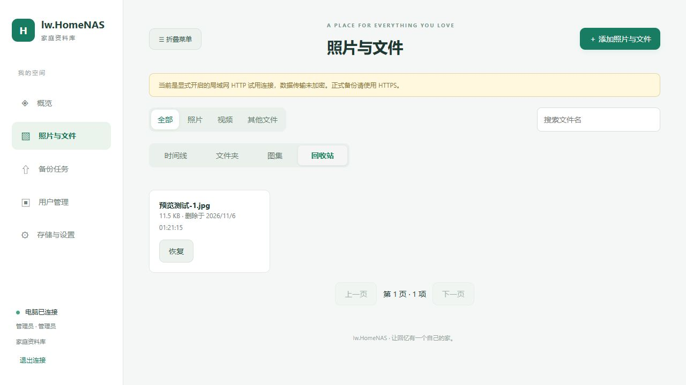

# lw.HomeNAS

简体中文 | [English](README.en.md)

自己的电脑做服务器，手机照片和视频备份到家里。

lw.HomeNAS 使用 **C++17 + cpp-httplib** 开发 Windows 后台，提供浏览器管理页面和 Android 客户端，也支持文档、录音及其他文件。目标平台为 Windows 10/11 x64 和 Android 10及以上。

**当前源码版本：1.5.0 · Android versionCode 32 · nativeApi 15。** 下载版本以 [Releases](https://github.com/lxw112190/lw.HomeNAS/releases) 中已公开的附件为准；源码版本、CI构建成功和目标手机验证是不同状态。

[下载发布包](https://github.com/lxw112190/lw.HomeNAS/releases) · [构建与 APK](https://github.com/lxw112190/lw.HomeNAS/actions) · [Web 使用](#web-使用) · [部署脚本](deploy/README.md) · [接口说明](docs/API.md)

## 可以做什么

- **手机备份**：按项、天、月或已授权范围全选照片/视频，支持排除单张，显示已备份/已入队状态；选择相册、备份目录及上传并发，备份中心展示扫描、摘要、上传与校验阶段。自动备份遵守系统调度限制。
- **大文件上传**：分块上传、确认偏移持久化、暂停/继续、失败重试、SHA256 完整校验及同一可访问目标内的内容去重。文件大小与偏移按64位处理。
- **照片时间线**：优先使用EXIF实际拍摄时间，缺失或无效时回退文件修改时间，再回退入库时间；旧照片后台补齐索引。Web/APK增加年、月快速定位和日期范围筛选。
- **Web 概览与查找**：容量进度、低空间提醒、照片/视频/其他文件数量、任务状态及常用入口；搜索跟随当前位置，支持文件夹递归搜索，分页提供首页、上一页、下一页和尾页。
- **整理资料**：默认以文件夹为入口，提供当前位置导航、照片/视频数量与占用统计、跨页选择和批量移动。支持最多16层目录及继承权限；主题图集保留为跨文件夹专题，不复制原件，额外操作收进“更多整理”。
- **资料库维护**：管理员在网页一键备份数据库、配置和分类，下载校验清单ZIP；整套资料可停服迁移到新硬盘/电脑，逐文件SHA256及数据库关系校验，源目录保留。
- **手机连接**：网页“连接手机”显示本机生成的二维码，App扫码填写地址、保留最近5台连接成功的服务器，测试连接报告地址、域名、TCP、证书或服务响应问题。扫码不会自动登录、信任证书或改变已认证队列。
- **回收站**：Web支持单项或批量移入回收站、分页浏览和恢复；保留原件及目录/图集关联。回收站不会自动清空，**移入回收站不释放磁盘空间**，手机自动备份不会将其悄悄恢复。
- **预览**：Web/APK图片缩放、拖动、原始大小和上一张/下一张；元数据默认折叠，展开后读取文件及可用的EXIF信息；APK显示可换行、长按选择的完整文件名。视频支持封面与浏览器/手机可解码格式的在线播放。
- **多账号**：admin/member/viewer 三种角色。管理员管理全部内容，普通用户按目录授权整理资料，只读账号不能因目录授权而获得写入权；管理员始终能管理全部资料。
- **部署维护**：Windows服务、开机启动、异常恢复、HTTP/HTTPS、7个BAT入口、独立安装日志、运行日志、手机日志轮转和诊断ZIP。
- **客户端维护**：固定签名APK覆盖升级与已签名网页资源更新；原生功能变化需要升级APK。

**资料库按目录权限展示。** 新建一级目录默认仅所有者可见，子目录继承并可进一步收紧；旧目录及默认文件夹保留兼容共享。文件夹是逻辑分类，同一原件可以关联多个目录，权限取所属目录的交集，移动只改变指定关联；图集不会额外授予访问权。



## 五分钟开始使用

1. 下载并完整解压Windows发布ZIP，保持 `NasServer.exe`、`web`、`config`、`deploy` 等目录结构。
2. 首次可双击根目录 `启动服务.cmd` 前台运行，浏览器打开 `http://127.0.0.1:8787/`。运行期间保持窗口打开。
3. 发布包全新资料库默认 **admin / admin123**，登录后修改密码；已有账号不会被覆盖。源码默认配置使用随机初始密码，见控制台或 `data/initial-admin-password.txt`。
4. 完整发布包的 `client-release` 文件夹包含APK及版本清单。启动NAS后自动校验并发布，手机打开网页登录页即可下载，无需先登录，也无需执行导入命令。可选的签名页面资源同时自动发布；后续仍可在Web设置页发布APK。较旧包不会覆盖已发布新版，管理员撤下后重启不会重新上架同版。[完整包说明](docs/20261112-完整包启动自动发布APK.md)。

5. 手机填写电脑IP和端口、登录账号，选择文件/相册和备份目标，再开始备份。手机与电脑先在可互访的家庭局域网使用。

### 安装为 Windows 服务

先退出前台NAS，再右键 `deploy/install-service.bat`，选择“以管理员身份运行”。安装后自动启动，并设置开机启动。只保留以下7个BAT：

| 文件 | 用途 |
| --- | --- |
| install-service.bat | 按配置安装并启动 |
| start-service.bat | 启动 |
| stop-service.bat | 停止 |
| restart-service.bat | 重启 |
| uninstall-service.bat | 卸载服务，保留数据 |
| open_firewall.bat | 开放配置端口对应的受管规则 |
| remove_firewall.bat | 删除本工具的受管规则 |

不覆盖已存在的同名服务。安装失败看 `deploy/logs/service-install.log`，程序启动后的错误看 `data/logs/service.log`。更多命令、1783诊断与权限处理见[部署说明](deploy/README.md)。

### 地址、端口与相对路径

配置位于EXE旁 `config/server.json`。路径相对于**配置文件目录**解析，不依赖启动时所在目录：

```json
{
  "data_dir": "../data",
  "web_dir": "../web",
  "ffmpeg_path": "../tools/ffmpeg/ffmpeg.exe",
  "http_port": 8787,
  "https_port": 9443,
  "allow_insecure_lan": true
}
```

以上仅为配置片段，修改发布包现有配置中的相应字段即可。改端口后重启服务，防火墙规则按新配置重新开放。服务模式和前台模式共用配置。

局域网HTTP按使用要求默认开启；发布包 `allow_external_hosts` 也默认true。HTTP传输不加密，公网部署需自行配置HTTPS、访问范围和云安全组。HTTPS自签名证书需核对并信任，不能关闭证书验证。

## Web 使用

### 概览

概览显示已入库文件、原件占用、磁盘可用空间和待完成任务，并提供照片、视频、其他文件、文件夹、图集、回收站和备份任务入口。点“刷新概览”同步统计和最近入库内容。

- 文件数量和回收站占用按当前账号可见范围统计；任务记录对管理员展示全部账号，对其他用户仅展示本人。
- 存储进度表示**所在磁盘**的已用比例，包含其他应用和文件，不等于NAS原件占用。磁盘可用空间不足5%时显示提醒。
- “任务已完成”表示对应任务已获服务端确认，不表示手机中所有文件均已备份。

### 选择目录与上传

1. 在“照片与文件”中进入目标目录，点击“上传到当前文件夹”；也可在“备份任务”中点击“选择文件夹”，展开目录树选定目标。
2. 点击“选择文件”或“选择本地文件夹”。选择本地文件夹后，可在目录树中勾选、排除单个文件或整层目录。
3. 默认勾选“按原文件夹目录上传”：在目标下保留所选文件夹及子目录，例如本地 `旅行/第一天/a.jpg` 保存到目标下的 `旅行 → 第一天`。取消勾选则将所选文件平铺到目标。
4. 确认所选内容后开始上传，保持页面打开。文件入库前校验完整SHA256；刷新页面后需重选相同文件才能继续。

空目录不上传。目录总深度最多16层；创建子目录需要父目录管理权限，同名目录会复用，遇到无权目录时停止并保留已加入的任务。更换上传目标只影响新任务，已入队和重试任务保持原目标。

### 文件名搜索与分页

| 所在位置 | 搜索范围 |
| --- | --- |
| 文件夹或图集列表的根目录 | 所有有权访问的文件 |
| 某个文件夹内 | 当前文件夹及全部可访问子目录，递归搜索 |
| 某个图集内 | 仅当前图集中的可访问文件 |

清空搜索文字恢复当前目录或图集浏览。“默认文件夹”也是一个具体目录，进入后按该目录范围搜索。搜索不扩大账号权限，回收站文件不会混入活动资料库结果；回收站页面单独搜索已删除内容。

资料库、文件夹、图集、回收站和上传任务列表提供**首页 / 上一页 / 下一页 / 尾页**。跳转保留当前搜索和筛选；服务器按权限定位尾页，只返回目标页，不把整库文件下载到浏览器。预览中的上一张/下一张仍仅针对已加载的当前页。

### 图标与图集封面

Web文件夹使用NAS服务器上Windows的默认文件夹图标；没有缩略图的文件尽量按扩展名显示对应的系统图标，取决于**服务器**安装的软件与文件关联，不是手机或浏览器所在电脑的图标配置。图标获取不打开上传原件。

图集优先使用手动设置的封面；未设置时，按图集展示顺序选择第一张有权查看且不在回收站中的照片。空图集或缩略图尚不可用时显示默认占位。

## 1.5.0 可靠性与维护

- 修复账号切换时旧首页响应残留、同属性不同内容文件漏入队、单文件移动确认、长中文目录上传、任务筛选请求竞争，以及文件名中的 `_` / `%` 搜索误匹配。
- 上传使用内容摘要参与任务标识；兼容同内容、同目标的旧任务续传。重复文件仍按目标去重，回收站中的文件明确提示“需恢复”，不会静默恢复或误报活动备份完成。
- Web新增文件列表/网格布局，以及名称、修改时间和大小排序；时间线按自定义排序时展示普通文件列表。目录/图集首页的容器顺序不受文件排序影响。预览可查看完整来源目录并打开所在文件夹。
- 上传整理显示进度并可取消；已入队任务保留。支持仅重试失败项、导出本次失败清单。图集可恢复自动封面，目录移动/升级/降级前显示成员权限变化预览（最多200个账号，正式移动仍重新校验）。
- **管理员 → 存储与设置 → 资料库健康与维护**：限速1–256 MiB/s检查原件大小/SHA256、目录关联及已生成缩略图是否存在；只报告异常，不修改原件。支持暂停、继续和取消。进程重启后标为中断，点击继续；暂停时未完成的当前文件会重新计算摘要。检查范围固定为开始时的 READY/MISSING 文件，包含回收站，不包含未完成上传或之后新增文件；只有一项检查可运行。
- 健康检查展示当前轮状态、完成时间及异常分页，可导出本页异常JSON。发现损坏后应先保留独立副本再处理；检查通过仅代表本轮检查范围。
- **定时数据库快照**：默认关闭，可设置1–720小时间隔、保留1–100份自动快照（默认7份）。服务需持续运行；失败约5分钟后重试。只清理超出数量的自动快照，手动快照与原件保留。快照存于资料目录的 `backups`，仍不包含原件，同盘快照不能替代独立备份。
- **操作历史**：管理员查看最近10000条目录、图集、改名、回收站、权限和维护操作，分页加载；不记录密码、令牌或文件内容。永久删除记录的是“已发起”意图，不把它当成已完成证明。此版本不提供操作历史的一键撤销。
- Android版本为1.5.0 / versionCode 32，识别服务端回收站状态；新增原生回归需由CI编译执行并经设备验收。没有新增原生桥命令，nativeApi仍为15。

## 文件操作

- **批量照片**：在Web时间线或图集/文件夹内点“选择文件”，可跨页选择、移入回收站、移动到文件夹或导出一个ZIP。时间线的“全选这一天”会读取当天后续分页，不仅选择当前可见的照片。每次最多1000项，写操作按100项分批执行并报告已完成数量。
- **批量回收站**：图片有缩略图，可放大查看；选择多项后可批量恢复。管理员批量彻底删除时仍需输入“彻底删除”确认。中途失败保留未完成项，不把整个批次显示为成功。
- **APK大批量选图**：全选已授权范围、按月/按天选择，支持取消月份、日期和单张；照片/视频可筛选，已备份和已入队状态可见。日期按文件修改时间分组。
- **分页加入队列**：整月和全选不再受旧的5000项总量限制，原生端每页100项核实并入队，显示进度，可停止后重试，已加入任务保留。显式勾选/排除单张仍各限5000项。
- **并发上传**：默认同时上传2项，可选1/2/3项，下次开始备份生效；各文件独立续传，总速度、剩余大小和各文件阶段分开展示。新能力需要安装code19或更新APK，实际手机速度仍需测量。[使用与验证](docs/20261106-APK整月选择与并发备份.md)。
- **图集交互**：添加绿色、编辑/移动蓝色、移出橙色、删除红色、导出紫色。进入图集的“添加照片 / 视频”后，已有成员标记“已添加”并排除重复选择；Web/APK均支持按天跨页选择。需配套1.0.2电脑端。
- **导出**：ZIP以流式方式直接下载，不在JavaScript内存中拼接整包，也不先在服务器生成临时压缩包。重名文件增加序号，文件内容保持不变；导出窗口中请按浏览器提示保存。

- **移动**：打开图片预览，点“移动文件夹”，选择目标；文件属于多个目录时可选择来源。也可进入文件夹，选择多项后批量移动。目标目录需有写入权限，原件不会在磁盘上重新复制。
- **删除/恢复**：图片预览中点“移入回收站”，或在资料库选择多项后删除。普通用户需具有文件整理权限；兼容共享默认目录保留上传归属限制，恢复另要求是本人删除。管理员可在Web回收站单个“彻底删除”，需输入“彻底删除”确认；成功后原件、缩略图及分类关联永久清除，所有成员均不可恢复。若显示“继续清理”，请解除占用后重试。手机本地文件保留，再次备份可能重新上传。
- **预览**：上一张/下一张作用于当前已加载的一页。Web可用左右方向键，图片可滚轮/双指缩放；“文件与拍摄信息”按需展开。APK的第一项是可换行、长按选择的完整文件名；顶部标题保持单行省略，避免挤占关闭按钮和预览区域。重命名后同步更新显示。缺失EXIF不推测。
- **音视频**：APK 1.0.1起，打开文件预览后点“播放视频/播放音频”，进入应用内原生播放器，可暂停、拖动进度和返回。使用手机解码能力，绕过WebView对HEVC等格式的播放限制；是否支持仍取决于设备，不保证所有编码。旧资料库中归类为“文件”的MP3也能识别。Web仍由浏览器播放；FFmpeg仅生成视频封面，不自动转码原件。

手机删除本地文件不会删除电脑原件。回收站是恢复机制，不能代替独立备份；重要内容建议另存第二份。

## 多级目录与权限

进入文件夹后点“新建子文件夹”；面包屑可跳回任意祖先，手机返回键逐级返回。“本层”统计不包含子目录文件；子目录数量仅包含有权查看的目录。移动整个目录保留ID和原件，禁止循环和超过16层。

Web进入可管理目录后，还可以调整整个文件夹的层级：

- **升级文件夹**：移到当前父目录的上一级。例如 `A/B` 升级为根目录下的 `B`；一级文件夹不能继续升级。
- **降级文件夹**：选一个有管理权限的同级文件夹作为新父目录。例如将 `A/B` 降级到同级 `C` 后，位置变为 `A/C/B`。

下级目录一起移动，目录ID、原件和既有上传目标保持不变。默认文件夹不能调整层级。操作前会确认目标和权限继承变化；同名冲突、权限不足、循环或超过16层会被拒绝。

新建一级目录默认“仅所有者”，子目录默认继承。管理者在Web“授权”（APK“目录权限”）设置指定成员的只读/可整理/管理权限；子级不能超过父级，也不能突破账号只读限制。管理员始终能访问全库，目录权限不是磁盘加密。

旧目录保留兼容共享，默认文件夹继续接收旧客户端备份，不会自动把已有资料改私有。旧多目录引用保留，**文件有效权限取所有所属目录的交集**；图集不额外授予访问权。收紧一处可能同时影响其他引用中的可见性，修改/移动/添加引用前请核对确认。

撤权或目标删除后停止上传，保留确认进度，不再回退到默认共享目录。恢复原目录权限后可继续；改用其他目标需要重新选择文件建立新任务。空目录才允许删除。跨目录重复上传使用独立文件记录，避免泄露私有文件的存在和名称；同一可访问目标目录仍可去重。

## 拍摄日期、备份与迁移

在Web或App的“时间线”中选择年份/月，或填写开始/结束日期（包含结束当天）。有效EXIF的时区偏移会参与换算；没有时区的拍摄时间按服务器本地时区解释，不从文件名猜日期。旧资料后台逐张补索引，页面显示剩余数量，完成后刷新即可。视频及无有效EXIF的照片使用文件时间。

管理员进入网页“存储与设置 → 资料库备份与迁移”，点“一键备份数据库与分类”。ZIP包含一致性SQLite快照、配置和SHA256清单，保留账号及目录/图集关系，**不包含照片视频原件**；不保存现有登录会话和明文初始密码。私下保管，不提交公开仓库。

整套资料换盘：先停止服务或前台程序，在安装目录的PowerShell运行：

```powershell
.\NasServer.exe --migrate-to 'D:\HomeNAS-New'
.\NasServer.exe --verify-library 'D:\HomeNAS-New'
```

目标必须是位于源程序/资料目录之外的空目录，不覆盖已有库、不删除源目录，不跟随目录链接。程序复制运行文件、原件、分类、账号和未完成上传文件，逐文件校验SHA256及数据库完整性/外键关系。日志、历史快照和初始密码便条不迁移。中断目标不会标为完成，也不能直接启动；请保留源目录并排查后换新空目录重试。

验证通过后，从新目录启动NasServer.exe；换电脑则把**整个已完成的迁移目录**复制过去，在新机再次验证后启动。服务需从旧位置卸载、在新位置重新安装，手机重新登录。TLS证书随库保留；新机地址若不在旧证书SAN中，需配置匹配的新证书并重新核对信任，不跳过主机名校验。保留旧目录，确认新实例可用后自行处理。校验清单针对迁移时刻，开始正常使用后数据库自然变化，不应拿旧清单校验运行中的现有库。

恢复分类快照时，先解压ZIP，保留当前库原件并停服，将快照恢复到另一处空目录：

```powershell
.\NasServer.exe --restore-backup 'E:\快照解压目录' --migrate-to 'D:\HomeNAS-Restored'
```

快照恢复数据库/配置和分类，原件从当前源库复制并对照快照检查；原件已丢失/变化会拒绝确认成功。元数据快照不能变出已删除照片，也不保证未完成上传的文件还在；这类任务会标为需要重试，授权失效时重新选择。要保留完整续传状态，请使用整套迁移。自定义配置可另加 `--config` 指定。完整说明见[本轮记录](docs/20261113-时间线备份迁移与手机连接.md)。

## 从旧版更新

1. 停止服务，备份原 `config` 和 `data`。
2. 替换EXE、web、deploy及工具文件，保留原配置和资料库。
3. 新版自动补充数据库表，保留原件、账号、目录及上传进度。移动安装位置时，先在旧位置卸载服务，再在新位置安装。
4. 当前源码配套Android版本为1.5.0/code32/nativeApi15，使用既有签名，可覆盖同签名旧版APK。目录权限功能请配套1.4.0或更新后台，并更新手机APK；不要仅向旧APK推送页面资源。升级保留账号与队列，按版本回到新内置页面；旧目标被删除或撤权后会停止，不自动改存默认目录。手机扫码需允许相机，不依赖Google Play服务。
5. 升级前留存完整数据副本，核对旧共享目录的成员权限；不要用旧程序回开已升级的资料库。发布包的默认配置只适用于新实例，升级时保留原配置及账号密码。

## 编译源码

Windows安装VS2022的“使用C++的桌面开发”和Windows SDK，使用 `lw.HomeNAS.sln` 的 Release/x64，或使用CMake入口：

```powershell
powershell -NoProfile -ExecutionPolicy Bypass -File tools/build.ps1
python tools/check-version.py
python tests/smoke.py --exe build/app/Release/NasServer.exe
python tests/recycle.py
```

SQLite、Mbed TLS、cpp-httplib等依赖已锁定；不要随意改变文件换行或跳过哈希校验。Android源码位于 `android`，使用Java及本地可信WebView页面，构建说明见[Android README](android/README.md)。本项目通过CI编译APK，不要求Windows后台运行Python、.NET或Android SDK。

## CI与正式发布

工作流入口为 [android.yml](.github/workflows/android.yml)（**Build APK, server and Release**），APK与Windows后台从同一提交并行构建。模拟器接续APK任务，完整ZIP等待两边构建和模拟器检查全部通过；最终组装复用同次CI的已测试EXE和固定FFmpeg，不从历史构建混取产物。

| 触发方式 | 结果 |
| --- | --- |
| 推送 `main` | 构建、验证并生成Actions产物，不发布Release |
| Pull Request | 编译和检查，不分发签名APK、不发布Release |
| 手动运行 | 仅生成构建产物；关闭 `emulator` 会跳过完整ZIP，不发布Release |
| **推送 `v*` 标签** | 标签必须与 `VERSION` 一致且指向本次已测试提交；全部检查通过后，才发布尚未公开的对应版本 |

Actions产物：

- `lw.HomeNAS-Android-N`：APK及签名/校验信息。
- `lw.HomeNAS-server-ciN`：不含APK的独立Windows后台包。
- **`lw.HomeNAS-full-ciN`：推荐下载的完整部署包**，包含后台、APK和校验清单。独立产物可在对应任务成功后下载，完整包需等待全部前置检查。

发布示例（先完成代码提交）：

```powershell
python tools/check-version.py
git push origin main
git tag -a v1.5.0 -m "Release v1.5.0"
git push origin v1.5.0
```

轻量标签和附注标签均支持。普通分支推送或手动运行不会触发正式发布；已公开版本和附件不覆盖，不要复用已发布标签。发布先上传到草稿，附件齐全并核对后再公开。失败可重跑同次运行的失败任务；产物过期时需重跑完整检查。

升版时同步 `VERSION`、`src/core.hpp`、`CMakeLists.txt`、Android versionName；APK原生或内置页面变化时递增versionCode。CI会检查版本一致性。历史工程说明见[并行CI记录](docs/20261113-APK与后台并行CI.md)，触发和发布规则以当前工作流及本节为准。

仓库Secrets继续使用 `ANDROID_KEYSTORE_BASE64`、`ANDROID_KEYSTORE_PASSWORD`、`ANDROID_KEY_ALIAS`、`ANDROID_KEY_PASSWORD`。`UI_SIGNING_KEY_BASE64` 可选，未配置时完整包使用APK内置页面。密钥、数据、真实日志和签名私钥不提交Git。

## 验证范围与限制

1.5.0已完成本地Windows构建、合成资料库回归及真实Chrome页面验证；APK生产页面另检查320px窄屏、横屏和长文件名布局。这不代表新版本已通过云端发布或Android真机验收。

每轮Windows测试使用独立合成数据，验证分块恢复、去重、权限、分类、回收站及原件一致性。Android编译/JVM/模拟器通过情况以对应CI为准，语法或页面检查不等于真机通过。Windows服务实际兼容以目标机实测为准；本次Win10教育版的1783故障在系统文件修复并重启后，用户已反馈安装成功。

当前不包含iOS客户端、RAID、端到端加密或全格式视频转码。目录支持成员权限，但不提供独立磁盘空间、配额或针对服务器管理员的加密隔离。Android后台备份受系统调度、省电策略、网络和权限限制；网页上传需保持页面打开。

## 项目与许可

Android方案参考 [lw.Web2Android](https://github.com/lxw112190/lw.Web2Android)，部署脚本参考 [lw.PPOCR.OpenCVDNN](https://github.com/lxw112190/lw.PPOCR.OpenCVDNN)。项目许可见[LICENSE](LICENSE)，第三方组件和FFmpeg许可、来源及源码归档见[THIRD-PARTY-NOTICES.md](THIRD-PARTY-NOTICES.md)与包内licenses/tools目录。

## 联系与支持

- 作者：天天代码码天天
- QQ：819069052
- QQ Group: 天天代码码天天 | 群号: 264292622

如果项目对你有帮助，可以扫码支持维护：


