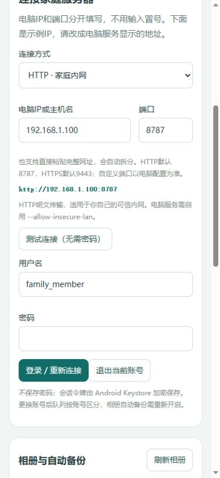

# Android 家庭备份客户端

源码版本0.3.1-dev（versionCode 4），兼容0.2账号权限版电脑服务；配合0.2.1可关联电脑请求日志。采用Java + 可信内置网页，沿用[lw.Web2Android](https://github.com/lxw112190/lw.Web2Android/tree/main/runtime)的WebViewAssetLoader方式，为NAS单独增加原生队列、传输、相册及后台调度。不修改普通Web2Android Runtime或现有通用打包器。

**当前状态：** [上一版CI](https://github.com/lxw112190/lw.HomeNAS/actions/runs/41775941648)的APK构建、lint/JVM测试及3项模拟器测试通过；随后截图步骤启动Activity失败。本轮已改为测试后重新安装APK、解析真实Launcher并收集日志，新增连接与日志测试。0.3.1的编译/设备测试等待用户推送后的CI。本机无Android SDK，未做真机验收。

## 不装Android环境，使用CI生成APK

1. 将本轮源码提交、推送到main。遵循用户约定，由用户执行git提交推送。
2. 在[GitHub Actions → Android APK](https://github.com/lxw112190/lw.HomeNAS/actions/workflows/android.yml)查看任务；首次推送会触发，也可点击Run workflow。
3. 构建任务执行lint、JVM测试、assembleDebug；成功后下载 `lw.HomeNAS-Android-运行编号` Artifact并解压。
4. 测试安装 `debug/app-debug.apk`。允许安装来源需由手机用户自行操作。Android 10及以上，建议使用较新的Android System WebView。
5. 模拟器任务执行Android 15的页面、原生桥及Keystore冒烟检查，上传报告和截图。它不能替代你手机的相册、后台省电和电脑局域网联调。

工作流：[../.github/workflows/android.yml](../.github/workflows/android.yml)。JDK17、Gradle8.11.1、AGP8.9.2、SDK35全部在CI准备；本地没有Gradle wrapper、Android Studio或SDK也可以使用该流程。[AGP兼容说明](https://developer.android.com/build/releases/agp-8-9-0-release-notes)。

### 签名与覆盖升级

默认Debug APK适合先试功能。不同CI运行可能生成不同的临时Debug签名，不能保证互相覆盖安装；卸载会清掉手机本地队列和授权，不会删除电脑原件。

长期使用或发给他人，准备自己的JKS签名文件，设置仓库Settings → Secrets and variables → Actions：

| Secret | 内容 |
| --- | --- |
| ANDROID_KEYSTORE_BASE64 | JKS文件Base64，保留原始签名文件离线备份 |
| ANDROID_KEYSTORE_PASSWORD | 密钥库密码 |
| ANDROID_KEY_ALIAS | 签名别名 |
| ANDROID_KEY_PASSWORD | 对应私钥密码 |

CI只在push或手动运行时使用这些Secrets；未配置时只生成测试APK。配置后还生成 `release/app-release.apk` 并用apksigner验证，SHA256在Artifact根目录。JKS、密码和Base64不提交Git、不粘贴在Issue或日志中。必须始终保留同一Package Name及签名身份才能覆盖升级。

没有JDK时也能准备签名：先设置两个密码Secret（均至少16字符），手动运行[Prepare Android signing key](../.github/workflows/android-signing-key.yml)。下载其中加密JKS，离线备份后将其Base64填入Secret，别名设为homenas；删除该Artifact，避免长期留在CI。密钥库仍需强密码保护，已经分发过正式APK后不要重新生成签名身份。PowerShell可用 `[Convert]::ToBase64String([IO.File]::ReadAllBytes("签名文件绝对路径"))` 取得内容；不要将命令输出保存进Git或公开日志。

## 手机连接与使用

1. 家庭HTTP模式：电脑运行 `deploy/start_console_http.bat`；Windows服务新安装用 `install_http_service.bat`，已有服务用 `configure_http_service.bat`。默认服务仍只对局域网开放HTTPS，HTTP需显式启用。
2. 手机首次显示HTTP、电脑IP示例 `192.168.1.100`、端口8787。将IP改为电脑真实局域网地址即可，不需要打冒号；协议和端口可以单独修改，也可粘贴完整URL自动拆分。点击“测试连接”，无需密码，先确认是否能访问。修改后测试或登录会记住地址；失败测试不会改变已有账号的会话和队列归属。
3. 输入用户名和密码登录。管理员名admin；可在电脑停止服务后用 `set_admin_password.bat` 设置好记的10位以上密码，再启动服务。建议为手机创建普通用户。资料库仍为家庭共享；viewer只能浏览下载。
4. 在“备份”选择照片、视频或文档/录音等文件；使用系统文档选择器的持久读取授权，加入本机SQLite队列。点击“立即备份 / 继续”。
5. 相册增量：先授权照片/视频访问，再到设置中刷新相册、勾选、保存；可立即扫描或打开定时备份。Android14+只授权部分照片时，软件只扫描实际授权范围，不称“全量备份”。权限缩小后需要重新授权和重试受影响项。
   如需保留照片中的原始位置元数据，点击“保留照片原始元数据”授权；对MediaStore使用requireOriginal。未授权时系统可能提供脱敏版本；第三方文件提供器也可能提供转换版本。摘要校验针对实际获准读取的字节，不能恢复提供器已移除的信息。授权变化后重新扫描会区分原始/普通读取URI。
6. 立即备份有通知进度和暂停；退出网页不删除本机任务。系统结束进程后可重新打开继续，先查询服务器确认偏移。只有服务器READY才显示“已备份”。
7. 资料库分页浏览共享文件、看图片缩略图；“保存原件到手机”选择保存位置，流式下载并核对完整摘要。当前没有Android端视频播放器/Range预览。下载需要保持应用打开，关闭或切换账号会中断，保存位置可能留部分文件。

手机和电脑在可互访的局域网，按需要允许电脑防火墙专用网络的8787（HTTP）或9443（HTTPS）入站；APK不自动开端口、不做外网穿透。

手机全新安装默认展示家庭HTTP模式，旧版已经保存的HTTPS连接保持原模式；HTTP密码和文件不加密，仅在信任的家庭内网使用。切换到HTTPS时，端口默认9443：电脑管理页导出**公开证书**及SHA256摘要，手机导入并核对摘要。不要传 `server-key.pem` 私钥。HTTPS失败不会自动降级或忽略证书，仍校验主机名/IP SAN；电脑IP变化后需重新核对配置及证书。HTTP模式不要求导入证书。

## CI → 真机 → 日志反馈

手机“连接与设置”底部提供“查看诊断日志”“导出诊断ZIP”，登录失败时也可使用。反馈问题时提供：APK版本/CI编号、操作步骤、发生时间、界面错误编号和导出的ZIP。需要电脑侧排查时同时提供对应时段的 `data/logs/requests.log`；请求trace标识可以关联两端。

日志包含版本/提交/CI编号、进程会话、设备/系统/WebView版本、网络类型、授权/电量/后台限制、连接主机和端口、桥调用、HTTP阶段/状态/耗时、任务编号/进度及异常调用栈。不记录密码、令牌、请求正文、文件名、媒体内容或原始URI。日志本地保存，单文件最多约2MiB，当前及4份历史约10MiB；不自动上传。ZIP只包含诊断摘要和日志，不包含数据库、会话配置或照片视频。查看窗口只展示末尾约32KiB。

以上为390px宽网页预览，使用模拟桥数据，不能代表真机备份结果。CI证据收集会在模拟器结束前保存启动结果、截图、logcat和应用日志；测试失败会保留失败退出码，不以截图成功掩盖测试失败。

## 自动任务与限制

- WorkManager约15分钟最小周期，按非计费网络、充电/低电量约束调度，每次最多约2分钟处理；不是拍照立即必达。
- 用户点击的大批备份走独立dataSync前台服务，持有限时WakeLock；主动限制约5小时，处理Android15系统超时通知。暂停不清除原件或确认进度。
- Android16对长WorkManager任务也有限额，因此不把全部历史备份放进永久长Worker。[官方说明](https://developer.android.com/develop/background-work/background-tasks/persistent/how-to/long-running)。
- 大文件初始SHA256需要完整顺序读取，若超过短批预算会等待后续再试，建议点立即备份。摘要中间态暂未持久化，暂停摘要后需重算；已确认的上传块无需重传。
- 系统省电、后台限制、强制停止、权限变化、网络隔离会影响调度。强制停止后请重新打开应用；不承诺所有机型熄屏后持续上传。
- 账号会话按现有电脑端策略过期：管理员1天，普通账号7天；过期、禁用或改密后需重新登录。令牌Keystore加密，不保存明文密码，网页拿不到令牌。
- 本地队列按服务器身份+账号隔离；切换账号后不自动上传上一账号选项，需重新开启自动备份。服务器资料库共享，不等于私人空间。
- 长期没有变化的READY源文件以本机版本信息跳过，暂不实现服务器原件的周期完整审计；第二硬盘副本、回收站、手机清理、完整超4GiB测试仍未验收。

## 项目结构

`app/src/main/assets/www` 为手机专用内置网页，资源相对路径；MainActivity只对该主框架开放固定WebMessage命令，不开放通用文件读取或任意HTTP代理。NativeApi使用原生流式请求，块最多8MiB；上传总长、偏移均为long，JSON传十进制字符串。TaskStore持久化幂等任务ID，断电或响应丢失后以服务器偏移为准；相册扫描每100项提交，避免每个文件独立刷盘。

当前通用Web2Android Packer以精简DEX注入为主，不支持直接携带WorkManager等完整资源依赖。因此本项目通过Gradle输出完整APK，**不把该APK/DEX冒充可直接注入的通用Runtime包**。`project.example.json`仅保留早期远程网页壳示例，不是当前原生备份客户端的构建入口。

源码布局检查：`python tools/check-android.py`；真正编译与测试以GitHub Actions报告为准。后续优先验证实际手机的文件选择、权限缩小、锁屏、进程回收、Wi-Fi断连、大视频恢复与原件下载。
