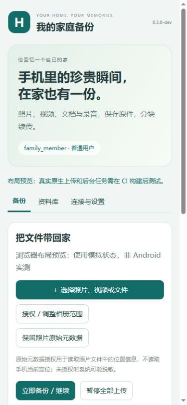

# Android专用客户端与CI构建

> 此文记录0.3.0初版实现时的状态。随后CI已生成APK并通过3项模拟器测试，截图启动失败；0.3.1修复与当前验证范围见[内网调试与诊断改进](20261104-内网调试与诊断改进.md)。

客户端源码0.3.0-dev，兼容电脑服务0.2.0-dev。用户明确本地没有Android开发环境，需要借助CI；本轮没有安装SDK或Android Studio，也没有执行git提交推送。

## 新增功能代码

内置网页和受限WebMessage桥，用户名密码登录、公开证书导入、Keystore加密会话；系统文件选择器持久读取授权、按范围读取MediaStore相册；SQLite持久队列、完整SHA256与原生流式分块上传；手动dataSync前台服务、通知进度/暂停、有限批次WorkManager；共享资料库分页、缩略图及流式原件下载/摘要核对。

后台任务不依赖WebView，页面只收状态。长文件不跨JS桥传base64；每块最多8MiB，长度和确认偏移为long，网页用十进制字符串。创建任务幂等，响应丢失不前移本机偏移，下次从服务器确认位置恢复；仅校验任务摘要、长度和READY状态后显示成功。

Android端缩略图请求复用当前会话的HTTP连接池，避免每张图新建客户端。扫描每100项提交；单个发送器和有界网页命令线程池控制占用。下载原件没有整文件35秒限制，仍保留读超时、取消和身份变化检查。

## 为什么单独编译完整APK

参照lw.Web2Android的Java + WebViewAssetLoader做NAS Runtime。通用Packer当前以DEX注入为主，WorkManager等还依赖资源/Manifest/初始化组件，因此使用完整Gradle APK构建；没有将新增DEX直接当作通用Runtime包，也没有改动上游项目。

## 已完成的本机检查

- Java语法解析、XML资源与清单解析、网页JS语法、GitHub Actions YAML解析。
- 手机页面在浏览器的390px布局预览，使用明确标注的模拟原生状态；备份、设置/相册、资料库页面未见横向溢出。不是Android截图或原生功能验收。
- 当前PC二进制及API未修改，之前的73项账号/传输检查、13项升级检查仍为PC版记录，不能计作新Android测试。

## 等待CI执行的检查

`Android APK`工作流执行Lint、JVM测试、Debug构建；配置签名Secrets后生成正式签名APK。Android15模拟器任务覆盖本地页面和原生桥、Keystore持久加密，以及实际ContentResolver → SHA256 → HTTP块上传 → SQLite确认进度流程。传输测试在本地模拟服务器接收第二块后断开响应，预期客户端旧偏移保留，再次运行按服务端偏移恢复，最终逐字节核对。测试只允许在隔离模拟器执行，不重置私人手机凭据。

这些测试已编写，**尚未执行CI，不能写为通过**。目前远程还未包含本轮源码，需要用户提交推送后才能构建；本轮没有可交付的APK。

使用、签名、工作流入口与限制见[Android README](../android/README.md)。真机重点验收：系统授权范围、文件提供器、锁屏/省电、强制停止、Wi-Fi断连、账号失效、大视频与下载取消。首次大量备份建议前台服务，定时短任务不承诺即时上传或无限运行。
