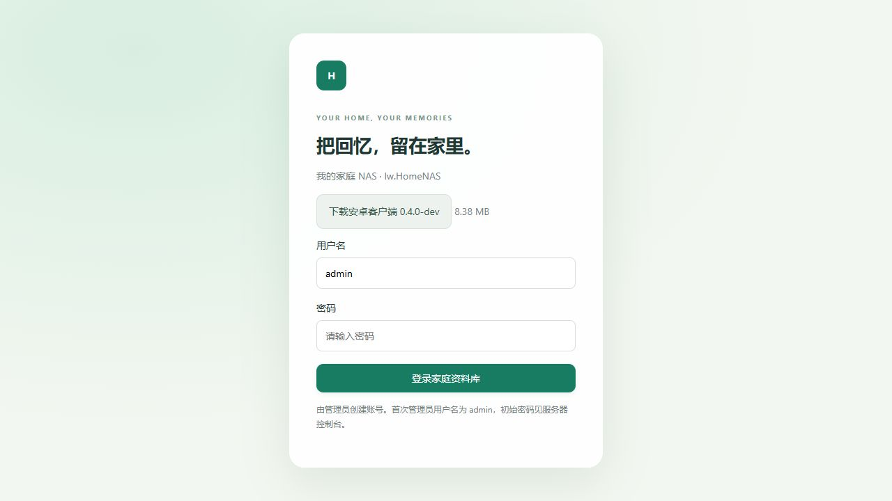

# CI3 Android安装包接收与发布

用户提供lw.HomeNAS-Android-3.zip。收到的唯一APK是Debug变体：包名com.lxw.homenas，版本0.4.0-dev，versionCode 5，大小8,788,069字节（约8.38MiB）。没有Release变体。

验证结果：外层ZIP和APK的CRC正确；APK SHA256匹配CI清单；独立校验APK Signature Scheme v2签名及全文件分块内容摘要通过；证书摘要匹配CI签名报告；APK内资源更新公钥与当前源码一致。没有安装或启动这个APK，没有进行手机功能验收。提供的Artifact不包含JVM/模拟器测试报告，因此不据此更新测试通过状态。

APK SHA256：`a36c5690ff705abd8457476b5298b560529d342b16221dc7880e15e17259a5ec`

Debug证书SHA256：`a5d1abf7f74c187a1c30e8fb2cd1e6be437497ba1aaa22482ae9ebcd3d16d04e`

后续APK需相同包名、兼容签名和递增versionCode才能覆盖升级。这是CI Debug签名，不代表今后每次CI都会继续使用同一密钥；长期发布仍应固定CI签名。资源更新使用另一套独立发布签名，本次APK已包含匹配公钥。

## 含真实APK的部署包

在原Windows部署包基础上增加client-release目录，包含真实APK、发布清单和校验报告；不包含任何私人数据或签名私钥。

更新已有服务器时，先停止服务/控制台程序，复制NasServer.exe、web、deploy和client-release，保留原config与data。在部署目录执行：

```bat
deploy\import_android.bat
NasServer.exe --allow-insecure-lan
```

导入脚本从当前EXE的配置解析data_dir，先核对APK摘要和长度，再取得资料库实例锁，复制到data/maintenance/packages并原子更新APK发布清单。不创建或修改账号、数据库、原件或上传进度。已有同摘要包复用；NAS仍在运行时拒绝导入。它会将当前APK发布切换为随包的0.4.0-dev，后续发布新版后不需反复运行此导入脚本。

启动后，未登录页面应显示“下载安卓客户端 0.4.0-dev”。端口及公网Host设置继续使用原config，例如8080与allow_external_hosts=true；不要用新包默认config覆盖已有配置。



也可以不使用导入脚本，登录网页“存储与设置”，上传APK，填写versionCode=5、版本名称0.4.0-dev后发布。

## 本次验证

在一次性目录进行离线导入、重复导入、公开版本查询、真实APK下载摘要校验、服务运行时实例锁拒绝检查；实际浏览器确认未登录下载链接和大小。未连接或修改用户公网服务器，未更改防火墙、未安装Windows服务。
