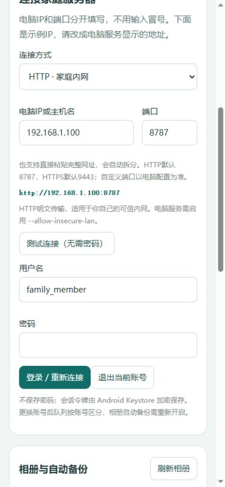
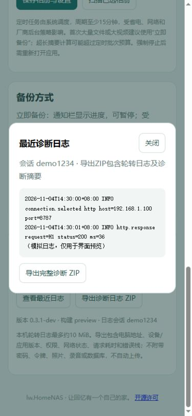

# 家庭内网调试与诊断改进

电脑服务0.2.1-dev；Android源码0.3.1-dev、versionCode 4。本机不安装Android SDK，用户自行提交推送后由CI编译，手机实际使用后回传日志。

## 更容易连接和登录

手机将协议、电脑IP和端口分开，首次提供可修改的 `192.168.1.100` / `8787` 示例，避免手机输入冒号；支持粘贴完整URL和全角冒号/点。连接测试只调用公开服务信息，不需输入密码。地址草稿单独保存，失败测试不修改已认证会话、加密AAD或原队列归属；已有HTTPS配置保留。

Windows服务原生入口支持 `--allow-insecure-lan`，新安装入口 `install_http_service.bat`，已有服务入口 `configure_http_service.bat`。后者只修改匹配当前程序路径的服务启动参数，原来运行则停止并重启，原来停止则保持停止，保留账号、数据和ACL。`configure_https_service.bat` 恢复默认模式；脚本不自动修改防火墙。HTTP传输密码和文件不加密，用于用户选定的家庭内网。

`set_admin_password.bat` 可在首次启动前或停止程序后自选管理员密码。至少10位，无强制大小写/特殊符号组合，例如自行输入 `nas12345678`；没有内置通用默认密码。离线工具取得实例锁，输入不回显，不存自选明文，不运行恢复线程；只重置内置管理员、撤销其旧会话，不改其他账号或原件。详见[服务操作步骤](../deploy/README.md)。

## 能够定位真机问题的日志

手机应用启动、系统/WebView版本、网络类型、桥命令、HTTP状态/阶段/耗时、任务状态与确认偏移、异常因果栈均记录会话和关联编号。错误弹窗附错误编号，原生请求附 `X-NAS-Trace`，电脑请求日志记录相同trace。两端时间均带时区，便于比对。

手机日志最多约10MiB，设置页可在未登录时查看末尾日志并导出ZIP；导出时短暂复制本地快照，再释放日志锁写入用户选择的位置，避免慢文件提供器阻塞备份。ZIP只有摘要和日志，无数据库/会话配置/照片视频，不自动上传。密码、令牌、请求正文、媒体文件名/URI不进入日志。电脑请求日志位于 `data/logs/requests.log`，约2MiB轮转，保留4份历史；另有服务启动日志service.log。

两张图均为390px网页预览和模拟桥数据，非Android真机运行截图。

## 本次CI失败

[运行41775941648](https://github.com/lxw112190/lw.HomeNAS/actions/runs/41775941648)中，APK任务成功，Android 15的3项仪器测试通过；失败发生在后续硬编码 `adb am start` 截图阶段。仪器测试工具可能在结束后清理应用，不能假设APK仍安装；同时applicationId和Java包名不同，启动入口不应靠字符串拼接。

新增证据采集脚本：保留Gradle退出码，读取构建元数据得到包名/APK路径，测试后重新安装，使用设备包管理器解析真实Launcher，启动并核对进程及PNG。即使adb对Error type 3返回0也会判为失败。模拟器关闭前收集启动记录、logcat、包/Activity状态及测试应用诊断日志；原测试失败不会被截图成功掩盖。

本机已通过：Windows VS2022及CMake构建、账号/备份恢复73项冒烟、旧库迁移13项、离线密码/内网HTTP/请求日志13项；12个批处理入口及两种服务计划/非SCM拒绝检查；CI采集脚本3项主机回归；Java语法、XML/JS/YAML检查。服务未在本机安装，没有改ACL/防火墙。Android新增JVM测试和4项模拟器测试需推送后跑CI，真机权限、锁屏、省电与大视频仍需实际验证。
