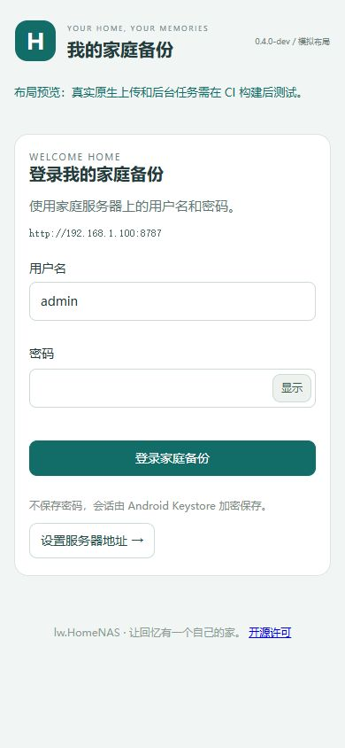
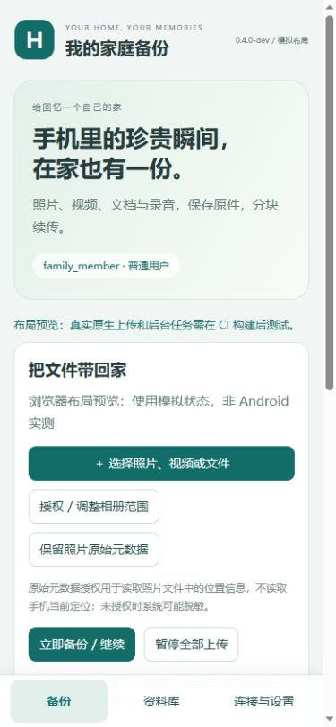
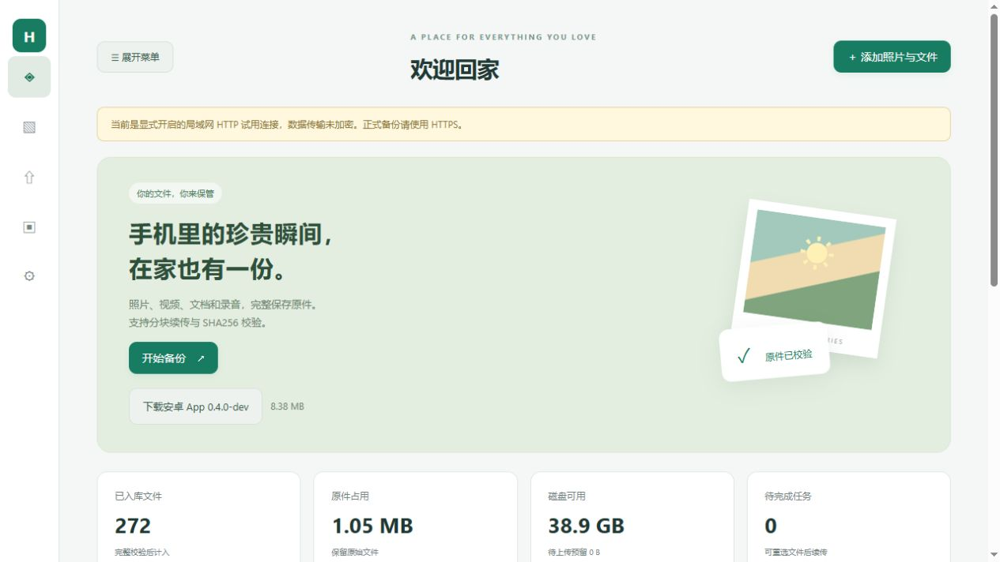

# 大批量备份、分页与页面拆分（2026-11-04）

## 版本和使用

电脑服务0.2.5-dev；部署包默认APK仍是已核验的CI3 0.4.0-dev / versionCode 5。Android 0.5.0-dev / versionCode 6只有源码，新增原生能力尚待CI构建与真机验收。

1. 停止原有NAS，完整解压部署包；升级既有实例时保留原有配置和data，先做备份。
2. 运行 `deploy/import_android.bat`，导入附带的默认APK与签名资源r2；然后启动NAS。不要覆盖或删除原来的data。
3. Web首页、登录页都可下载APK。已有该默认APK不必重新安装，在原设置页“检查更新 → 下载资源更新”，关闭后重新打开，使用新登录页。
4. 登录页点“设置服务器地址”修改IP/端口、测试连接，再返回登录。登录成功后显示“备份 / 资料库 / 连接与设置”底部栏。退出账号回到登录页。用户名密码与原服务一致。
5. 新建/重置密码最少6个字符；已有密码保持有效。Web和安卓密码框均有显示/隐藏按钮，提交后恢复隐藏。

资源更新不是APK升级。r2的minNative=1，兼容默认APK；签名ZIP包含安卓专用HTML/CSS/JS，私钥不在部署包中。新页面不会让旧原生APK凭空增加接口。

## 大批量处理

Web本次选择列表每页50项，支持状态筛选、上一页/下一页、清理本次完成项。清理只移除页面引用，不删除服务器文件。批量导入每200项让出主线程，使用Map判重，调度索引避免反复扫描所有完成项。并发保持2，不盲目增加连接和磁盘压力。

同一文件复用一个SHA256 Worker完成整文件及各块摘要；显示摘要读取字节与百分比，页面绘制节流，批量完成时合并刷新。仍然先计算整文件摘要再上传，首个大视频依然需要读取完整内容。分块有界缓冲、64位偏移、重选续传和服务器最终整文件校验不变，不能据此承诺大文件秒传或固定倍数加速。

资料库每页48项，前后翻页替换DOM；服务器任务每页50项并按状态过滤。后端增加有序索引和稳定的created/id游标，读取limit+1判断下一页，保留旧tasks数组接口供默认APK使用。文件内容和任务归属不变，资料库仍为家庭共享。

Android 0.5源码：原生队列每页50项、按状态筛选，SQLite分页使用scope/id索引；选择文件上限5000项，入队按100项事务提交；已有队列先上传，再扫描相册；摘要进度限频，减少反复网络状态查询。以上待CI/真机验证。

默认0.4 APK搭配r2：资料库继续用原生已有游标翻页；原生队列只返回最多100项，页面分成每页50项，并明确提示上限。新版原生筛选/全队列分页入口在旧APK中隐藏，不调用不存在的桥方法。

## 页面结构

| 位置 | 用途 |
| --- | --- |
| web/index.html | Web外壳、顶栏、可折叠侧栏 |
| web/views/ | login、home、library、transfers、users、settings、dialogs |
| android/app/src/main/assets/www/index.html | 安卓独立外壳、底部导航 |
| android/app/src/main/assets/www/views/ | login、backup、library、settings、dialogs |
| 两端各自的boot.js | 并行加载固定本地片段，完成后绑定app.js事件 |
| 两端各自的app.js和style.css | 各自交互与样式，HTML不再塞在一个文件中 |

从服务地址访问Web，不直接双击HTML；安卓页面通过WebViewAssetLoader本地加载，分片不依赖远程网页。C++只显式注册已知Web文件，不开放任意文件目录。权限继续由原生会话及后端验证，不能依靠隐藏菜单代替认证。

修改单个页面时编辑对应views文件；保持被JS引用的控件ID。增加Web页面时同步更新index中的加载槽和server.cpp静态文件白名单；增加安卓片段时放入www/views，会随签名资源打包。两端均使用相对资源路径，配置与workspace路径规则不变。

## 验证结果与边界

- Windows CMake / VS2022 Release x64编译通过。
- 84项备份回归通过：页面资源、认证/角色、6字符与Unicode密码边界、分块续传、异常恢复、原件/Range下载、EXIF方向等。
- 10,001条文件+10,001条任务的隔离元数据分页测试通过：无重复/漏页、筛选、账号任务隔离、无临时排序的索引计划；不是上传10,001份真实大视频。
- 13项HTTP/管理员维护、16项客户端维护、8组SHA256边界/分块校验通过。
- 浏览器真实上传120个8KiB测试文件，全部READY、失败0；拆分后另完成重选去重与112KiB新文件上传，分页每次替换48项。
- Web登录/首页默认APK链接、菜单收起记忆、密码查看已验证；安卓页面通过模拟原生桥检查登录→设置→登录→底部导航→退出及390px宽度无横向溢出。插图为模拟布局，不能代表Android设备测试。
- Android 22个Java文件语法、XML、JS检查通过；新增登录导航和501项原生队列分页CI仪器测试，尚未在本机执行。
- PowerShell/批处理解析及防火墙计划检查通过；未在开发机安装服务或修改防火墙。APK/资源离线导入在独立测试目录验证，可重复导入并保留更高资源版本。

未验证完整超4GiB真实媒体上传、万级真实相册扫描、手机长时间后台策略或公网吞吐量。性能提升以减少页面/调度开销为主，不给出未经基准测试的速度倍数。
