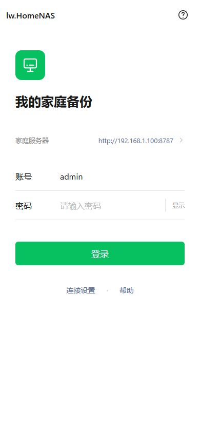
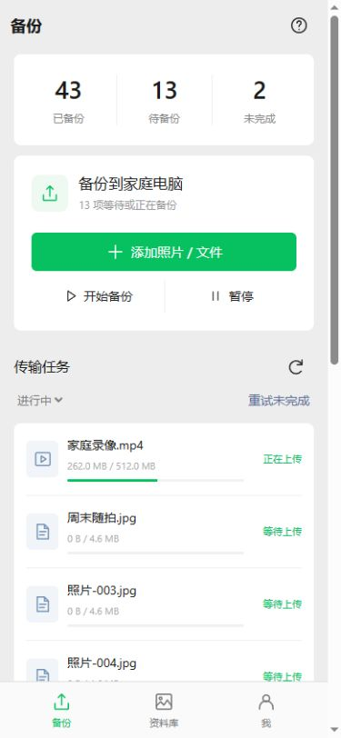
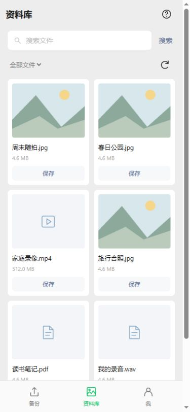
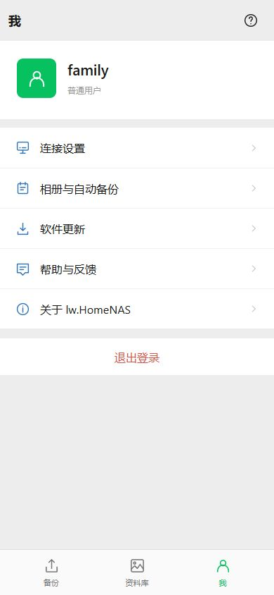

# 安卓简约界面 r3

> r3包含许可证TXT，与现有APK解包白名单不兼容，已由r4修复。请使用[最新资源r4](20261104-资源解包失败与r4修复.md)；下面保留界面设计及早期模拟验证记录。

本轮仅修改安卓本地页面和交互，采用类似微信的浅灰背景、白色列表、绿色主按钮及简约底栏。保留lw.HomeNAS自己的名称和图标，不依赖外部字体、图片或UI框架。Web管理页面独立维护。

## 使用新界面

已经安装的CI3或CI5 APK无需重装。将本轮部署包中的client-release与deploy更新到服务器，停止NAS后执行 `deploy/import_android.bat`，再启动服务。原config和data继续保留。

手机仍显示旧界面时，进入“连接与设置”，点击“检查更新 → 下载资源更新”，关闭并重新打开应用。新界面以后从“我 → 软件更新 → 更新界面”更新。没有修改APK或重新签名，因此这次界面更新不会引入新的APK覆盖安装签名问题。

也可在Web“存储与设置”上传本轮的 `ui-r3.zip` 和对应 `release.json` 发布资源。两份文件必须配套。

本轮完整包仍附带已核验的CI5 0.5.0-dev / versionCode 6原始APK，**APK自带的仍是CI5构建时的界面**。全新安装后同样更新资源r3，才能看到此次简约版；源码中assets则已经是新界面。无需为了本次样式重做APK。以后修改Java原生能力再通过CI生成递增versionCode的APK。

## 改了什么

- 登录：账号、密码、服务器入口与登录按钮，去掉宣传长文，保留密码显示和连接设置。
- 备份：三个状态数字、添加文件、开始/暂停、传输任务。长说明收进帮助，权限和元数据设置移到“我”。
- 资料库：搜索、文件类型、缩略图/文件卡片和分页，保存按钮精简。
- 我：账号信息以及连接、相册、更新、帮助反馈、关于五组列表，设置默认收起。
- 底栏固定为“备份 / 资料库 / 我”；登录前隐藏，连接设置可直接返回登录。
- 连接、证书、相册选择、定时/Wi-Fi/充电选项、日志查看/导出/上传和更新功能保留。
- 操作反馈改为短时提示，错误仍展示；定时刷新不再反复将页面滚回顶部。任务与资料库翻页后定位到新列表开头。

手机窄屏浏览器预览如下，全部为模拟账号、模拟任务和生成的示例缩略图，不是真实相册或真机截图。

## 兼容与验证

资源revision=3、minNative=1，沿用同一资源签名公钥，兼容已分发CI3和CI5。原生接口、账号验证、上传协议、数据格式没有变化。旧桥没有原生队列分页/搜索时保留现有降级：队列最多显示最近100项并分50项展示，隐藏不支持的筛选/搜索入口。

本轮已执行：JS语法检查、安卓资源/CSP检查及10项现有CI脚本单元测试；组合页面ID唯一、静态事件目标完整；r3签名与13个源文件一致，未包含mock预览代码。隔离服务器验证了r3上传摘要、发布清单、下载字节一致及未登录发布拒绝。

浏览器模拟桥验证了登录、地址测试、显示密码、50/8项任务翻页、文件搜索、相册开关与保存、帮助/日志弹窗、退出隐藏菜单；旧桥分页降级及只读账号隐藏上传入口也已检查。390px页面及360px设置页未发现横向溢出，控制台无错误。翻页后列表定位到顶栏下方。

本机没有编译、安装新APK或进行Android真机资源激活测试；后台备份、系统授权与手机软键盘最终效果仍需真机验收。没有改动防火墙、Windows服务或用户公网服务器。
