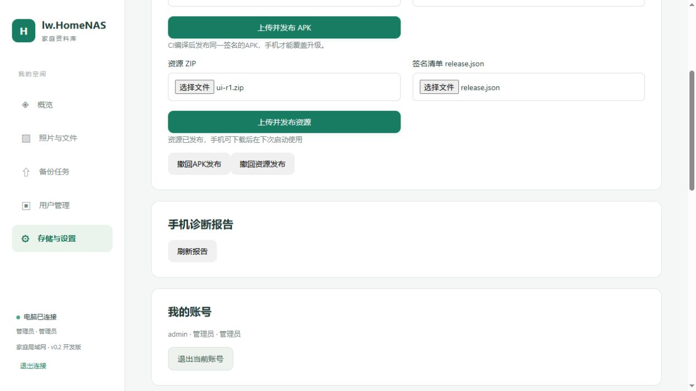

> 后续已收到CI3真实Debug APK并核验，含APK包的导入方法见[CI3发布说明](20261104-CI3安卓安装包发布.md)。本文保留功能开发时的状态与操作说明。

# 客户端更新、APK下载、诊断报告与防火墙脚本

电脑端0.2.4-dev，Android源码0.4.0-dev / versionCode 5 / 原生桥协议1。当前没有真实新版APK随包发布，需用户推送后通过CI编译。旧APK需要先安装这一版，才具备资源更新、日志上传和APK安装入口。

## 使用顺序

1. 停止旧服务，更新EXE、web及deploy，保留config和data。
2. 登录网页，打开“存储与设置”。“安卓客户端发布”可以上传APK并填写准确的versionCode、版本名称和说明。发布后，未登录页面就会出现APK下载按钮；未发布时明确显示尚未发布。可撤回发布，已下载的文件不会被远程删除。
3. CI编译的0.4.0 APK应使用长期固定签名。旧Debug签名若不同，系统不能覆盖安装，先核对签名，不应直接卸载丢掉手机待传队列。首次安装此版后，设置页提供自动检查结果、手动检查、资源下载、APK下载安装和日志上传。
4. 手机下载资源后，下次重新打开时启用；本次WebView会固定使用已加载版本，不中断备份。资源加载后由页面确认就绪，未确认的版本在下一次打开时退回前一版；APK内置资源始终保留。
5. 手机可填写500字以内的问题描述并上传诊断ZIP。成功显示报告编号；失败保留临时快照供下次点击重试，也可继续用原有导出ZIP功能。上传需要有效登录和服务器连接。
6. 管理员在网页刷新诊断报告，可查看报告编号、账号、描述、时间、大小，下载ZIP或删除。报告不进入共享媒体库，仅管理员能查看。



截图来自本机隔离测试库，APK发布使用不可安装的合成占位文件验证上传和下载接口，非真实APK安装测试。真实安装包等待CI产物。

## 平时只更新资源

修改 `android/app/src/main/assets/www` 中的HTML/CSS/JS，然后在源码根目录运行：

```powershell
python tools/build-ui-bundle.py --revision 2
```

生成 `deliveries/ui/ui-r2.zip` 和 `release.json`，在网页同时选择ZIP和签名清单发布。每次发布使用新的正整数revision。此步骤不需要Android SDK、不重新编译APK。Python签名工具需要cryptography包。

源码根目录本机已有 `local-signing/resources-private.pem`，它与Android中的ResourceTrust公钥配对。**请单独离线备份这个资源签名私钥。** 它已被Git忽略，也不会进入部署包；不要发给普通用户。丢失私钥后，不能继续给现有APK签发资源，只能通过升级APK更换信任公钥。签名工具会拒绝使用与当前源码公钥不匹配的私钥。

也可将此私钥的Base64设置为仓库Secret `UI_SIGNING_KEY_BASE64`，手动运行GitHub Actions的“Android UI resources”，输入递增revision，下载签名资源Artifact。该流程只打资源，不装Android SDK。仅修改assets资源不再触发APK工作流；原生代码或Manifest变化仍触发APK构建。

资源使用RSA/SHA256发布签名及ZIP的SHA256和长度校验；下载到应用内部目录后展开。限制文件数量、展开大小和允许的文件类型，拒绝目录越界。不动态加载DEX或SO，新增原生权限/能力仍需APK升级。APK另外核对包名、versionCode和当前安装证书，调用系统安装界面；需要用户授权安装来源及确认，不能承诺静默升级。

## 防火墙

右键以管理员身份运行：

- `deploy/open_firewall.bat`：读取当前EXE所用config/server.json，开放配置的HTTP/HTTPS TCP端口，规则限制到该EXE路径，适用所有网络配置文件。
- `deploy/remove_firewall.bat`：删除该EXE路径对应的受管规则，不操作其他软件规则。
- `deploy/status_firewall.bat`：查看规则状态。

端口变更后重新运行open脚本，会更新此程序路径的规则。脚本不会自动配置云厂商安全组，也不因服务卸载自动删除规则。安装目录移动后，旧路径规则需在原目录运行remove后再迁移。

仅查看计划、不修改系统：

```powershell
powershell -NoProfile -ExecutionPolicy Bypass -File deploy/firewall.ps1 -Action Open -PlanOnly
powershell -NoProfile -ExecutionPolicy Bypass -File deploy/firewall.ps1 -Action Remove -PlanOnly
```

## 存放与接口

更新包及发布清单位于data/maintenance/packages和data/maintenance；诊断包与元数据位于data/maintenance/reports。均相对既有data_dir，无需修改配置。更新包按摘要命名，已发布包不可原地覆盖；撤回只删除发布清单，历史安装包保留供维护者离线清理。

公开GET：`client/latest`、`client/packages/{sha256}.apk`或`.zip`。需管理员：`admin/client/{apk|ui}/blob`流式上传、`admin/client/{apk|ui}/publish`发布、DELETE `admin/client/{apk|ui}`撤回。登录账号POST `diagnostics`上传日志；管理员GET `admin/diagnostics`列出，GET/DELETE `admin/diagnostics/{id}`下载/删除。以上均以/api/v1为前缀。

APK上限128MiB、资源ZIP上限20MiB、诊断ZIP上限16MiB。采用有界缓冲流式读写，原有备份分块仍按chunk_bytes限制。尚未提供更新下载断点续传、资源差分补丁、自动清理全部服务器历史更新包或无人确认安装。

## 验证边界

Windows服务编译、新接口16项和原有73项备份回归通过；真实浏览器完成占位APK及签名资源上传发布，确认未登录APK下载入口。防火墙只检查解析与Open/Remove计划，本机没有创建/删除规则。Android源码通过本机语法、XML、JS检查，新增回退单元测试待CI运行；签名验证、系统安装和真机资源切换未在手机验收。
