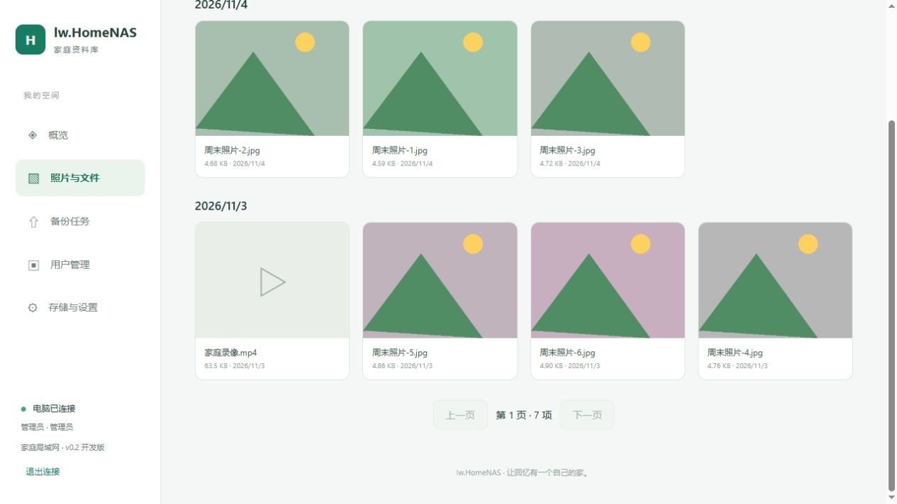
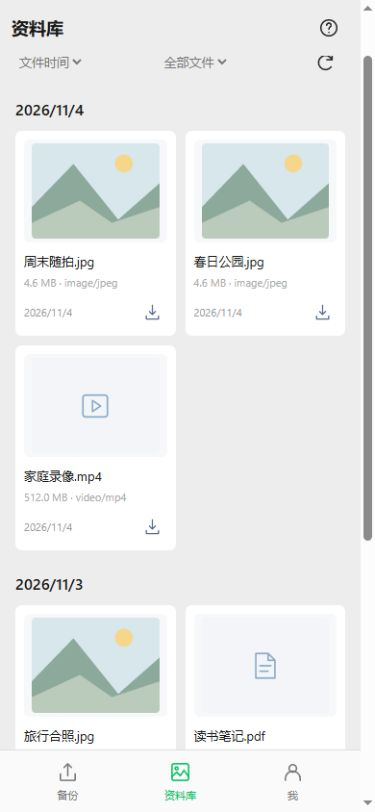
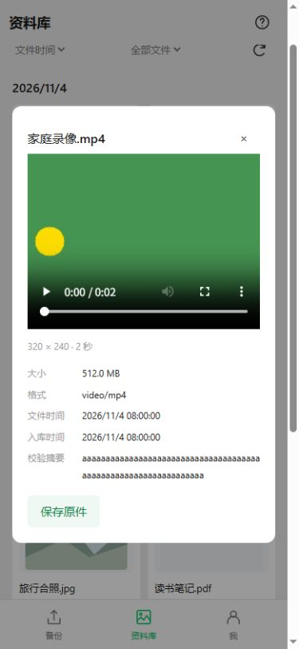
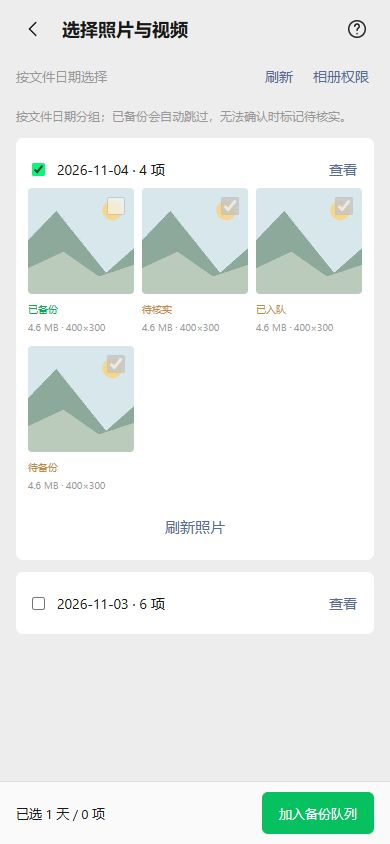

# 时间线、媒体预览与按天选择

> 后续已收到并核验 CI7 APK，完成 0.3.0 部署包和签名资源 r5，见[发布说明](20261104-CI7安卓安装包发布.md)。下文保留源码开发阶段的验证记录。

电脑服务源码升级为 **0.3.0-dev**；Android 源码为 **0.6.0-dev / versionCode 7 / nativeApi 3**。本轮先交源码，由用户提交到 CI 编译；收到新 APK 后再制作完整部署包。本机没有 Android SDK，本轮没有编译或安装 APK。

## 照片与视频时间线

Web 与 Android 资料库新增“文件时间 / 入库时间”排序，按天分组、游标分页。文件时间取文件最后修改时间，缺失时回退入库时间；它不是 EXIF 拍摄时间。分组使用浏览设备的时区。跨页同一天可继续显示同一日期标题，不一次加载整个资料库。



卡片显示文件大小、日期；打开详情可看格式、文件时间、入库时间，Android 还显示 SHA256。图片尺寸、视频尺寸和时长在成功解码后显示。Android 保存原件改为小图标，保留明确的可访问名称。

Android 原图与视频通过本地同源流式代理预览，视频支持单段 Range；令牌和整段原件不会交给 JS。关闭预览、退出账号会关闭流；并发最多 4 路。能否播放仍取决于设备 WebView 的格式和编码支持，本版不做视频兼容转码或视频封面。





## 手机按天选图

“备份 → 选择照片和视频”打开应用内按天选择页；“选择文件”继续使用系统文件选择器。应用只读取用户实际授权的照片/视频，部分授权不等于整个相册。日期按文件修改时间和手机时区分组。

每批显示最多 30 个日期，每日缩略图每页 50 项；可勾选整天或逐项选择，单次最多加入 5000 项。整天选择会处理该天授权范围内的文件，不只处理当前显示的一页。超过上限会提示分批选择。整天选中时先取消日期勾选，才能切换为逐项选择。



绿色“已备份”需要同时满足：当前账号本机队列记录匹配媒体身份、大小与修改时间；电脑再次确认该任务为 READY；服务端摘要、大小匹配且原件仍存在。核实按 100 项一批执行，本机用索引查询队列，不预先计算整本相册摘要。原件缺失时允许重新备份，网络失败显示“待核实”，不会当成成功跳过。

这是基于本机历史记录的核对：卸载重装、另一台手机上传、文件提供器无法映射到同一媒体身份时，可能显示待备份。它不代表电脑一定没有该文件；重新备份仍会经过完整 SHA256 去重。选图前不重新读取每个文件的全部字节，文件身份/大小/时间也不能替代最终完整摘要校验。

旧 APK 可继续使用系统文件选择器及降级界面；应用内按天选图和原件视频预览需要新 APK，电脑也要升级到 0.3.0。仅更新网页资源不能增加原生桥能力。

## 部署默认值

下一次收到 CI APK 后制作的部署包，由 `tools/package.ps1` 在包内配置：

```json
{
  "allow_external_hosts": true,
  "bootstrap_admin_password": "admin123"
}
```

全新数据目录首次建立的管理员为 **admin / admin123**，登录后在“存储与设置”修改密码。此配置只在首次初始化生效；重启或更新程序不会重置已有账号密码。源码默认配置仍保留外部 Host 关闭及首次随机密码；打包脚本只修改暂存包内配置。所有运行路径仍相对于配置目录解析。

`allow_external_hosts` 控制 Host 接受范围，不会自动开放监听、防火墙或切换 HTTP。需要 HTTP 时继续使用 `deploy/start_console_http.bat` 或对应 HTTP 服务脚本；端口由配置或现有启动参数设置。

## 本轮验证

- VS2022 Release x64 编译通过；原生冒烟 84 项、万条资料/任务分页 9 项、时间线与备份核对 9 项、首次密码 4 项、HTTP/管理员 13 项、真实 0.1 数据库升级 13 项、客户端维护接口 16 项通过。
- 服务/防火墙脚本只验证计划和参数；未安装服务或改动开发机防火墙。
- Android 25 个 Java 文件语法检查、页面/CSP/事件入口检查和 15 项主机回归通过。新增模拟器仪器测试覆盖按天选择、核对成功后跳过、原件缺失不标绿、预览 Range 与退出中断，等待 CI 执行。
- Web 用独立测试服务实际入库 6 张合成图片和 1 段合成 H.264 视频，核对两种时间排序、图片尺寸和视频播放。Android 截图为浏览器模拟原生桥，已检查按天选择、小保存按钮及预览，无控制台错误；不代表 MediaStore、原生代理或真实手机已经通过。
- 本轮未制作部署 ZIP、未发布新签名资源、未执行 Git 提交和推送；已有 CI5 APK 与 r4 包保持原版本。
