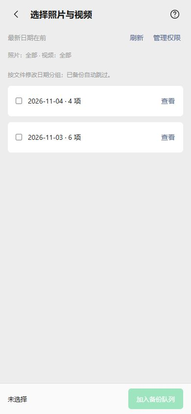
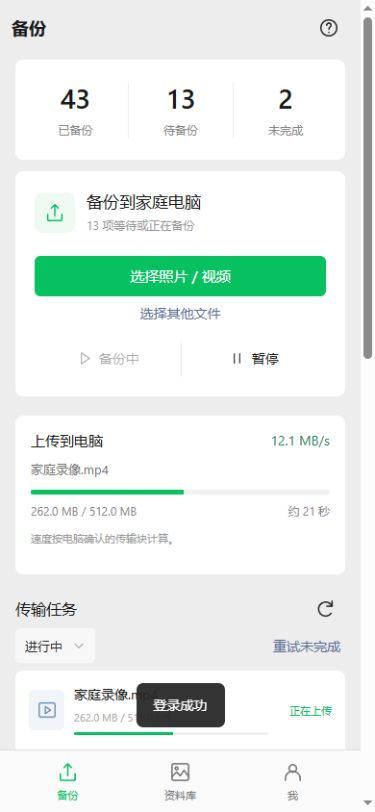
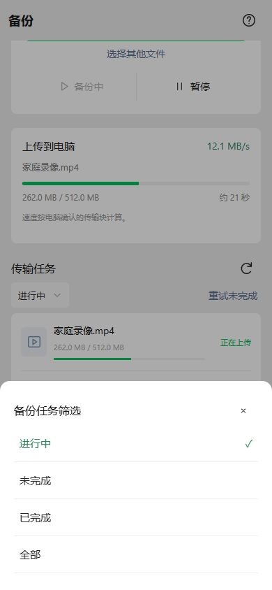
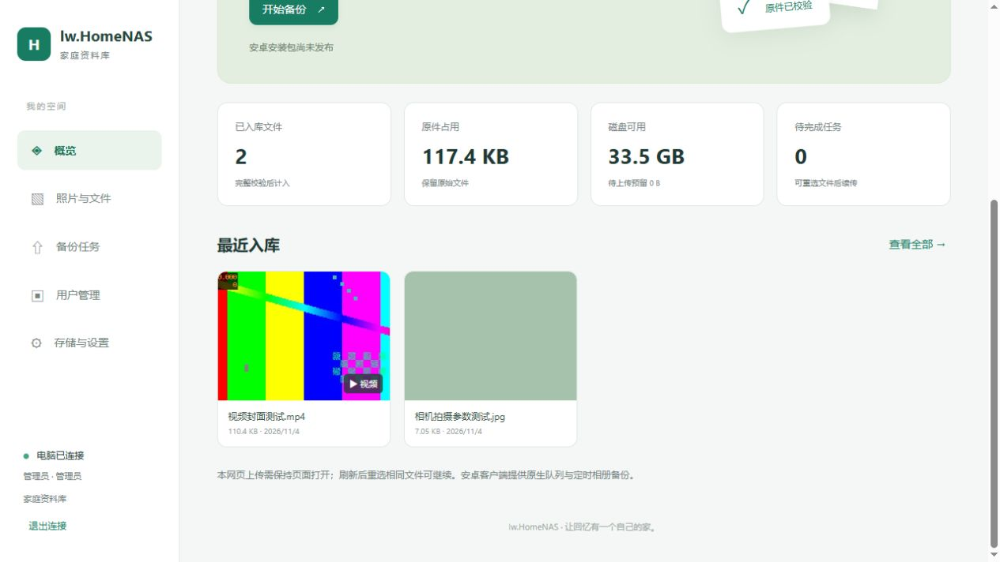
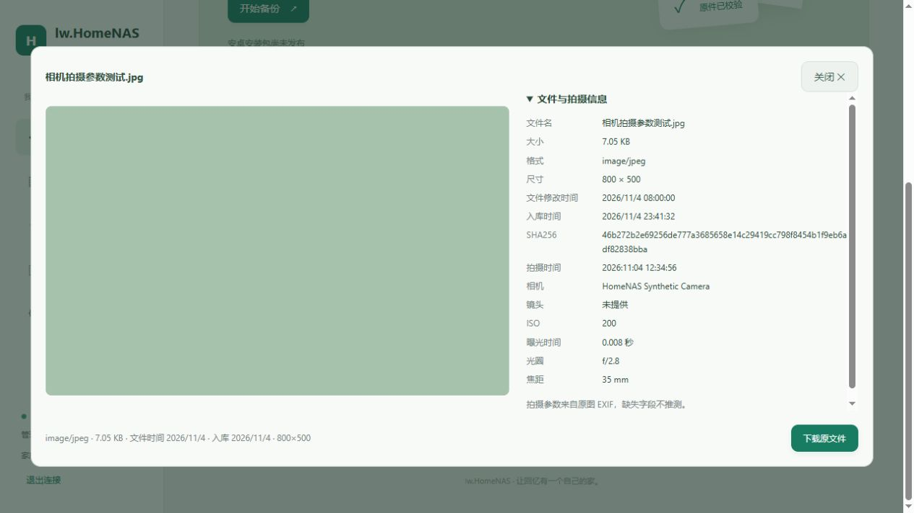

# 相册权限、媒体详情与备份页打磨

> 2026-11-05 已接收并核验 CI9/code9，发布完整部署包，配套资源 r6 和 FFmpeg。[发布说明](20261105-CI9安卓安装包发布.md)。下文保留开发阶段的验证记录。

本轮电脑服务源码为 **0.3.1-dev**，Android 源码为 **0.6.2-dev / versionCode 9**。已分发包仍是 CI7/code7，不会用旧 APK 冒充本轮版本。用户提交到 CI 后生成新 APK，再据新 Artifact 制作部署包。

## 相册权限和日期列表

旧入口每次都申请同一组权限；系统已授权全部时可能只返回结果，不再弹窗。现在按实际授权状态处理：首次申请、部分授权重新选择、完整授权进入系统设置、拒绝且无法再次弹窗时进入设置。Android 14+ 的部分授权保留“重新选择授权”，旁边提供“允许全部 / 系统设置”。不能绕过 Android 授权；自用设备在系统里允许全部照片和视频后，就可以在软件里按天或按相册选择。

权限状态常驻显示“照片：全部/仅所选/未授权 · 视频：…”，不再把原始位置信息说明混进每次授权提示。从设置或系统选图返回，以及权限回调结束时，刷新实际权限与列表；先前缓存的选择会失效，避免把旧范围当成当前范围。

日期查询已改为显式 `date_modified DESC, _id DESC` SQL 排序。旧实现混用 SQL selection 和结构化 sort 参数，某些 Provider 不合成排序时，代码又只取最前 31 个日期，可能把新日期漏掉。现在若 Provider 仍乱序，会报可诊断错误，不静默截断。日期依据文件修改时间，不是 EXIF 拍摄时间；只显示系统实际授权和已索引的本机媒体，不会自动获取云相册中尚未下载的原件。



平台规则参考：[Android 部分照片访问](https://developer.android.com/about/versions/14/changes/partial-photo-video-access)、[ContentResolver 查询参数](https://developer.android.com/reference/android/content/ContentResolver#QUERY_ARG_SQL_SORT_ORDER)。新增 CI 测试用故意忽略结构化排序的 Provider，检查最新日期及连续 80 天分页，不把本地语法检查当作此测试已运行。

## 上传进度、界面和提示

备份页增加当前文件面板，分开显示准备、摘要读取、上传、电脑校验、入库；上传速度按新发送且经电脑确认的块计算，平滑显示单文件剩余时间。续传时不把历史偏移算作本轮速度，摘要读取也不算上传流量。“文件已发送”和“已备份”分开表达，仍需服务器 READY 才成功。

任务列表按任务 ID 局部更新，刷新时保留未变化的行。工作中约 2 秒刷新、空闲约 5 秒刷新；通知与提示节流，电脑返回重复确认时不反复写 SQLite。校验轮询逐步放缓至最多 2 秒，完整 SHA256、确认偏移落盘和暂停续传规则保留。未做双会话或并发发送，不宣称固定速度提升倍率，实际吞吐仍需真机测量。



下拉选择改为贴底选项面板；输入框去掉绿色外框/发光，使用浅灰焦点。选择仍同步原有筛选和连接设置，保留键盘焦点和可访问名称。



## 视频封面和播放排查

视频 READY 后由独立后台线程调用 FFmpeg 取第一帧，生成最长边 640 像素的 JPEG。每次一个进程、单线程解码/滤镜、低优先级、20 秒超时、512 MiB 进程内存限制，限制输出体积；退出 NAS 会终止它自己创建的任务。封面不占上传校验线程，失败只令封面不可用，不修改或重新编码原视频，不把已入库文件改为上传失败。

配置新增可选相对路径：

```json
"ffmpeg_path": "../tools/ffmpeg/ffmpeg.exe"
```

路径相对于 `config/server.json`，空字符串禁用。不依赖系统 PATH。将可信 FFmpeg 和随附许可证放在源码 `tools/ffmpeg` 后，VS2022、CMake 和打包脚本会复制该目录。本轮没有捆绑二进制，集成测试依赖仅在被忽略的 `test-results`；下次分发时需将正式依赖一起整理。缺少 FFmpeg 时仍正常备份/播放；安装依赖并重启后逐个补旧视频封面。



找到并修复一处明确的播放阻断：MKV/AVI 以前虽然归类为视频，MIME 却是 `application/octet-stream`，被原生代理拒绝。服务端修正新记录并在启动时修复旧记录；APK 对旧服务器的这两类记录也做有限兼容。新增 MPEG/TS/3GP 的正确类型，不把任意文件放进预览白名单。

播放失败区分读取错误、解码错误和不支持格式；诊断记录错误码、MIME、WebView/系统版本及设备解码器信息，不记录文件名、媒体 URI 或播放字节。MIME 修复不能让设备支持所有编码；部分 HEVC、高位深或特殊音轨仍可能不支持，保留保存原件后用系统播放器打开的方式。本轮未实现整段视频兼容转码。

## Web 图片元数据

预览增加大小、格式、方向修正后的尺寸、文件修改时间、入库时间及 SHA256。原图存在可读 EXIF 时显示拍摄时间、相机、镜头、ISO、曝光时间、光圈和焦距。没有的字段显示“未提供”；拍摄时间保留原 EXIF 表达，不擅自推断时区。使用 WIC 读取原图元数据，只显示有限字段，不展开整个二进制 EXIF。



切换文件、关闭预览会取消上一次元数据请求，避免后返回的数据串到另一张图片。所有文本通过文本节点显示；新 API 与原件使用同一登录权限，不暴露磁盘路径。

## APK 日志轮转

保留当前 `runtime.log` 加 4 份历史日志，每份最多 2 MiB，轮转日志约 10 MiB。启动清理超过保留编号的旧轮转文件。日志页显示策略和当前占用，导出摘要带 `log_policy`。导出 ZIP 不计入这 10 MiB 轮转日志额度；只导出日志与安全诊断摘要，不附带照片或账号密钥。

回归测试扩大到超过 5 份容量，检查保留最新内容、淘汰最早内容、导出不含媒体/凭据。这是新增/扩展的 CI 测试，尚待本轮 CI 执行。

## 验证边界

- VS2022 Release x64 编译通过。Windows 原生冒烟 84 项、时间线 9 项、万条资料/任务分页 9 项、首次密码 4 项、真实旧库升级 13 项通过。
- 新增真实媒体集成 13 项通过：EXIF 类型和数值、方向尺寸、权限、缺失 FFmpeg 仍成功备份、配置后补封面、封面失败不损坏原件、MKV MIME 等。
- Android 31 个 Java 文件语法、页面/CSP/事件目标、15 项主机回归与两端 JS 语法检查通过。新增权限分支、日期 Provider、传输速度、类型兼容及轮转回归等待 CI 编译执行，本机不安装 Android SDK。
- Web 用真实隔离服务核验 JPEG EXIF、FFmpeg 640×360 封面及 H.264 播放；Android 在浏览器模拟原生桥，390px 无横向溢出，面板贴底、灰色输入焦点、筛选和权限刷新正常，无控制台错误。模拟结果不代表原生权限、实际手机播放或上传速度已经验证。
- 不自动提交 Git；未打本轮新 APK/部署包，未改用户的运行实例、防火墙或已分发 CI7 包。
