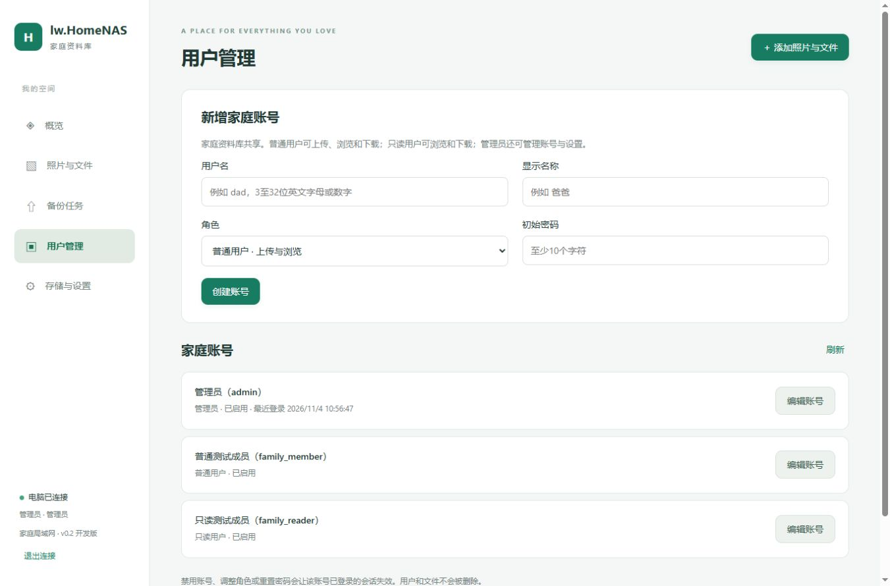
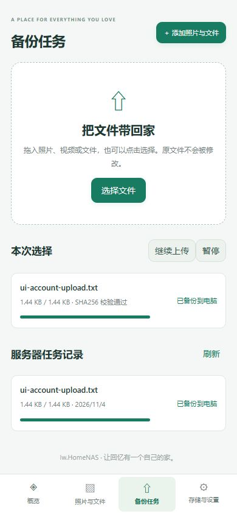

# 0.2账号权限与Windows服务部署

日期：2026-11-04。按用户要求，用用户名与密码替换配对码；提供简单角色权限。保留同一家庭共享资料库，暂不实现个人文件隔离。用户自行提交、推送Git。

## 账号权限

- admin：管理账号、查看全部任务、上传及浏览下载。
- member：上传、管理自己的任务、浏览下载共享资料。
- viewer：浏览下载共享资料。界面隐藏上传入口，服务端同时拒绝上传、写块、完成与取消请求。

管理员可创建账号、调整角色、启停账号及重置密码；每人可修改自己的密码。禁用、改角色、改密会撤销旧会话。至少保留一个启用管理员。默认用户名admin，首次密码随机生成，不附带固定密码。

schema 1升级到2保留原管理员密码、服务器及TLS身份、文件原件和确认偏移；撤销旧配对凭据。旧任务归管理员，原设备来源记录保留。用真实0.1程序建立独立旧库后升级，13项迁移检查通过。升级前应停服务并备份整个资料库，升级后不要用旧程序打开新版库。

## 服务部署

参考[lw.OpenCVDNN.PPOCR部署目录](https://github.com/lxw112190/lw.OpenCVDNN.PPOCR/tree/main/server/deploy)的操作入口，新增原生SCM服务模式与七个批处理。使用独立虚拟服务账号，程序目录读取执行、数据目录修改；安装不覆盖同名服务，卸载保留数据。

启动阶段周期上报SCM检查点；监听成功后才报告运行。停止调用HTTP/TLS停止入口，退出前等待已有处理收尾。启动错误写入服务日志，日志初始化前的错误同时尝试写Windows事件日志。不输出初始密码到服务日志。

脚本检查包含PowerShell语法、七个入口、中文/空格路径及安装计划、非SCM环境拒绝`--service`。这些检查不安装服务，不更改ACL或防火墙。实际SCM安装、服务账号读写与启停需目标机验证。

## 验证范围

账号/传输自动检查、迁移检查及实际浏览器角色检查使用独立测试目录和自动生成材料。浏览器验证管理员用户页、只读限制、手机退出和普通成员前台上传，桌面1366与手机390像素宽度无横向溢出。最终构建及包内检查见[验证结果](验证结果.json)。

Android专用Runtime、真机后台自动备份、外网访问、第二硬盘副本、超4GiB文件完整传输与真实断电仍未验收。
