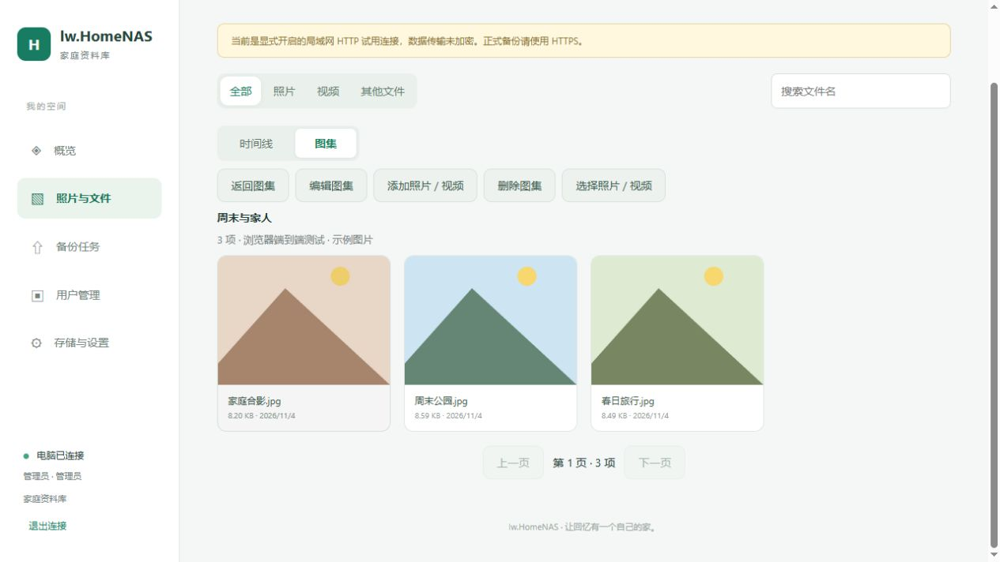
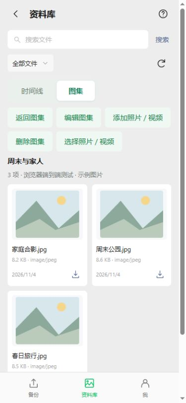

# 图集、时间线与手机返回键

电脑服务源码 **0.4.0-dev**；Android 源码 **0.7.0-dev / versionCode 10 / nativeApi 4**。本轮 APK 需要推送后由 GitHub Actions 编译，尚未真机验证。旧 CI9 APK 和已有完整部署包仍是历史版本，不包含本轮原生桥扩展。

## 如何使用

Web 的“照片与文件”和 APK 的“资料库”均提供 **时间线 / 图集** 双按钮切换。已去掉“入库时间”展示选项。

1. 切换“图集”，选择“新建图集”，填写名称与说明。
2. 打开图集，点“添加照片 / 视频”，到时间线中选择项目，点“加入图集”。也可以直接在时间线点“选择照片 / 视频”，勾选后选择目标图集。
3. 图集内可编辑名称、说明；进入选择模式后可移出所选内容，或选一项作为封面。
4. 移出内容和删除图集都保留服务器原件；照片和视频仍在时间线中。同一原件可以加入多个图集。

图集列表和图集内容每页最多 48 项，通过“上一页 / 下一页”浏览。每次写入最多 100 项；“全选本页”仅选择当前页的照片、视频，翻页清空当前选择。图集内容支持文件名搜索和照片/视频筛选；文档、录音仍在时间线中浏览。

时间线依据文件修改时间分组，缺少有效修改时间时回退到入库时间；不是 EXIF 拍摄时间。原件元数据详情仍保留入库时间字段；旧客户端的 `order=created` API 兼容性保留。

## 权限与数据

- 当前资料库及图集对家庭账号共享。只读用户可浏览；普通用户管理自己创建的图集；管理员管理全部图集。
- 权限检查在服务端执行，不能依靠隐藏按钮绕过。
- `albums` 保存图集信息；`album_items` 保存关联关系，联合主键防止重复。删除图集仅级联删除关联，不删除 `assets` 和磁盘原件。
- 批量加入、移出、修改封面都在 SQLite 事务内完成。无效文件导致整批回滚。封面必须属于当前图集，移出封面后自动选用剩余成员。
- 在既有账号迁移后增量创建表，不重置原件、账号、上传确认偏移。现有 schema2 继续兼容。
- 所有运行目录仍按配置文件目录解析，相对路径约定不变。

## 手机输入与返回

输入框和多行文本框聚焦时不再出现外侧描边、阴影，保留正常静态边框。按钮的键盘焦点提示仍保留。

系统返回键和页面左上角返回使用同一层级：先关闭编辑/选择/预览等弹层，再退出批量选择，再从图集详情返回图集列表，之后返回备份首页；照片选择页返回备份，未登录的连接设置返回登录。首页返回关闭 Activity；已明确启动的原生备份服务继续遵循原有前台服务规则。外接键盘 Escape 也沿用此逻辑。保留传统系统返回分发，尚不提供预测返回动画。

## 升级与界面资源

1. 先更新电脑服务与 Web，再通过 CI 编译、安装新 APK；旧 APK 没有图集原生命令，单纯更新页面不能替代 APK 升级。
2. 新 APK 首次启用 nativeApi4 时，撤下旧的活动/待启用网页资源指针，使用 APK 自带新界面。保留登录、任务、备份与服务器原件。
3. 本轮签名界面资源为 **r7 / minNative4**，输出在 `deliveries/ui-r7-albums/`。新 APK 不再接受 r6 及更早界面资源，避免将新功能降回旧界面。后续修复发布更高 revision。
4. r7 资源按现有 APK 解包路径、类型、数量和大小限制校验，再签名。签名私钥不进入源码或交付包。未发布到用户服务器。
5. 用户提供 CI10 APK 后再核验签名、版本和内置页面，并制作新的完整部署包；当前未将旧 CI9 APK 冒充新版本。

新增接口：`GET/POST /api/v1/albums`、`GET /api/v1/albums/{id}/items`、`POST /api/v1/albums/{id}/{edit|delete|add|remove|cover}`。列表为游标分页。Android 仅开放 `albumList`、`albumItems`、`albumChange` 固定桥命令，不允许页面传任意 URL。

## 本机验证

- Windows Release x64 编译通过，运行入口 `build/app/Release/NasServer.exe`。
- 图集 13 项真实服务检查：角色与归属、重复加入、事务回滚、封面成员校验、移出封面、两种列表分页、搜索、删除保留原件。
- 84 项上传/账号/恢复冒烟、13 项旧库迁移、9 项时间线回归通过。
- Android 源码与资源布局检查、18 项主机检查、31 个 Java 文件语法解析、两端 JavaScript 语法检查通过；这些不等于 Android 编译。
- 实际浏览器完成 Web 图集创建、批量加入、封面设置；Android 页面使用模拟原生桥与真实隔离服务验证创建、目标图集选择、加入、弹层/详情/主页返回。390px 窄屏无横向溢出，聚焦输入框 computed outline/box-shadow 均为 none，无页面控制台错误。
- Android Gradle、Lint、JVM/模拟器测试及真实系统返回键需继续经 CI 与手机验证。
