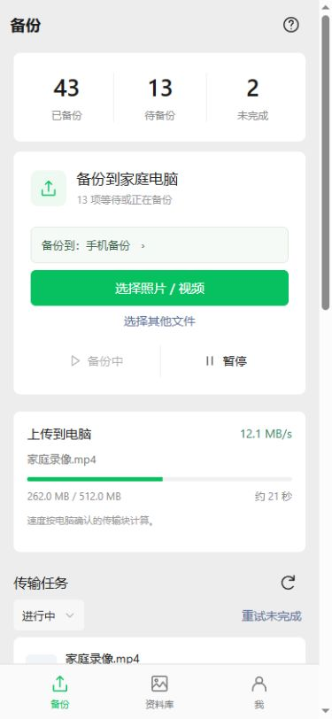
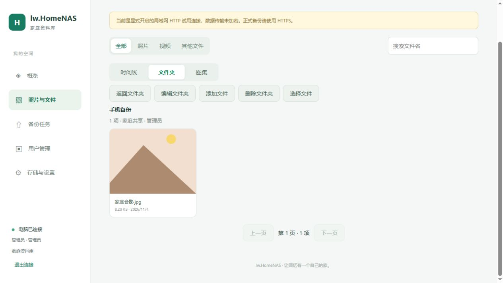
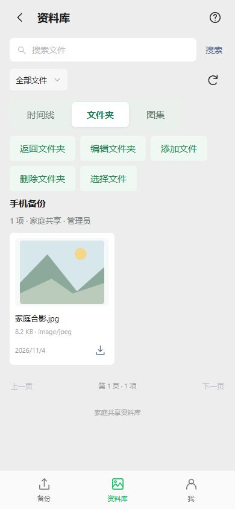

# 备份文件夹

电脑服务0.5.0-dev；Android源码0.8.0-dev / code13 / nativeApi7。延续共享家庭资料库，增加一级逻辑文件夹。原件仍按内容存储，文件夹不接收手机提交的磁盘路径。

## 使用

APK备份页点击“备份到：默认文件夹”，选择或新建目录，再选择照片、视频或其他文件。自动备份设置中也有相同入口，首版手动和自动备份共用当前目标。目标按服务器身份与账号分别记住，切换账号不会混用。

目录在加入队列时固定。修改当前选择只影响新任务，已有任务继续显示各自原来的目录。旧任务升级后使用默认目录，保留本地ID、幂等client、摘要、远端任务ID、状态及64位确认偏移。

Web和APK资料库均可切换“时间线 / 文件夹 / 图集”。文件夹支持新建、改名、说明、分页、按文件名搜索及移动文件；普通文档、音频也可加入。图集仍用于照片视频的主题整理。当前普通网页上传继续进入默认目录，APK可选择上传目标。

## 权限及默认目录

所有用户共享浏览。管理员管理全部目录，普通用户管理自己创建的目录，并可备份到默认目录；只读用户不能新建或写入。选择备份目标时只列出当前账号可写的目录。不同创建者可以使用相同名称，列表标注创建者。

默认目录不可改名、不可删除。普通用户只能从默认目录移走自己确认上传过的文件。管理个人目录的引用，不会获得该原件的全局改名权限。

现有文件自动补关联到默认目录，原件不搬动。删除目录时，其中文件归入默认目录；其他目录或图集的关联保留。上传中的目标被删除后回到默认目录，任务返回明确标识。APK在选择媒体、系统文件或扫描前检查目标，发现目录已删除会更新后续默认目标；已有任务保留原请求目标，由服务端回退。目标权限不足时暂停并提示重新选择，不擅自改投其他个人目录。

## 去重和再次备份

同一原件允许关联多个目录，磁盘仍只存一份。已备份但不在当前目录的照片显示“已备份 · 可加入此目录”，可以选择加入；已在当前目录的项目继续跳过。

手机队列将目录纳入去重键，同一来源可以有不同目录的任务。可复用相同账号、URI、大小及非零修改时间均匹配的已确认摘要，服务器仍核对原件存在。内容去重成功后只添加关联，无需再次传输媒体字节；如果原件丢失则按原有流程重新上传并完整校验。缺少可靠修改时间时重新计算摘要。

目录关联与READY状态在同一事务内提交，提交中间态及恢复路径也补目录关联。旧客户端不传folder_id仍进入默认目录。请保留config/data原地升级；旧服务程序不维护目录关联，升级后不再使用旧服务写入该库。

## 验证和发布

本机CMake与直接VS2022工程编译通过。真实隔离服务22项目录检查通过，覆盖权限、去重、目标不可改、目录删除回退、跨用户默认目录保护、重启续传、旧库迁移及两级分页；86项冒烟、13项图集、14项改名、9项时间线、13项真实0.1迁移及16项维护接口通过。

20项Android主机检查通过，其中2项直接执行本轮Java队列源码里的SQLite建表/升级SQL，核对迁移保留64位确认偏移和幂等身份；这不等于在Android中执行Java。新增JUnit覆盖真实队列升级、按目录区分任务、已确认摘要复用、偏好账号隔离、目标删除回退及选图目标变化保护，等待CI。9项发布主机检查、20项Node工作流断言、选图模型和JavaScript语法通过。

Web实际浏览器完成创建目录、选择文件移动、数量更新，并回归图集创建/添加照片。手机页面使用390×844浏览器、模拟原生桥与真实隔离服务，验证目标选择、已备份照片可加入新目录及目录浏览；不是新APK真机验收。截图仅使用合成媒体。

APK需要CI生成0.8.0/code13，沿用既有签名。新原生协议7，签名页面资源需minNative7；首次升级回到新版内置界面，保留账号和队列。完整发布CI已加入folders.py，不能用旧APK替代新原生目录能力。本机没有Android SDK，未编译或安装新APK。
