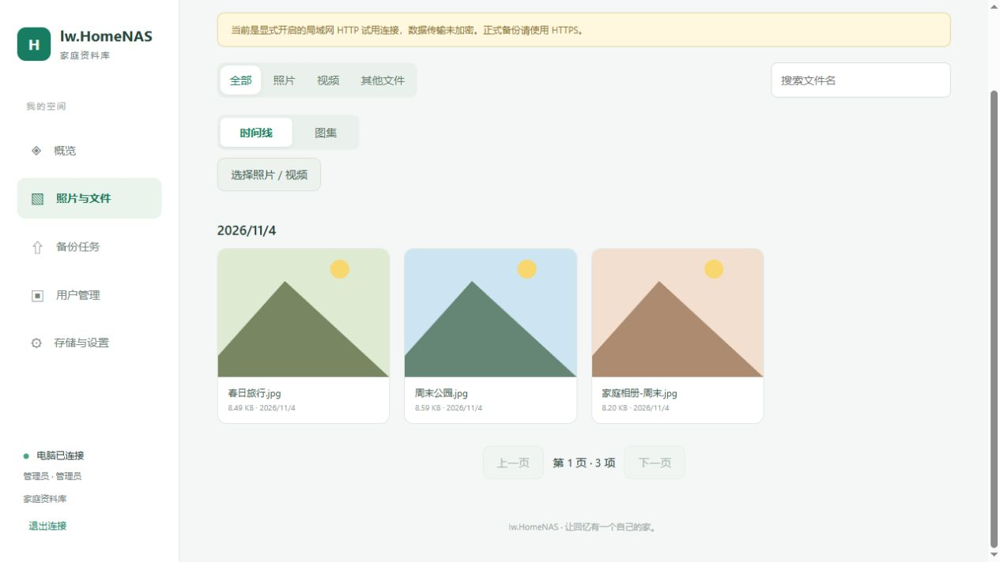
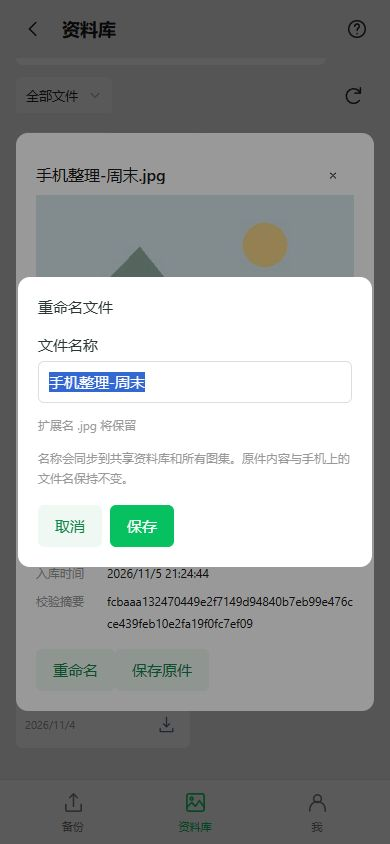

# 文件重命名（0.4.1 / Android 0.7.1）

后续开发源码已合并选图排除与图片缩放，Android递增为0.7.2/code12/nativeApi6；本文0.7.1/code11是重命名阶段记录，未单独分发。[当前版本](20261105-选图排除与图片缩放.md)。

在 Web 或 APK 的资料库打开文件预览，点击“重命名”，输入新名称并保存。照片、视频和普通文件共用此入口，时间线、图集中的文件都支持。输入框只编辑名称主体，原扩展名单独显示并保留；取消或返回关闭不会提交。

## 名称和权限

- 管理员可改全部文件；普通用户可改自己已上传过的文件；只读用户不显示入口，服务端也拒绝写入。
- 资料库是共享的，同一个文件在所有图集、搜索结果及后续下载中使用新名称。内容去重后，多名确认上传过该内容的普通用户都可以改名。
- 原件内容、校验摘要、文件ID、时间线时间不变；不修改手机上的原文件。重新备份同一内容仍去重，也不会把新名称覆盖回旧名称。
- 空名称、过长名称、路径字符、控制字符、Windows保留名称会被拒绝。多人同时改名时，后提交的旧编辑返回冲突，刷新后再改。
- 本轮为单文件改名，未增加批量编号或批量改名。

## 升级与实现

电脑源码版本0.4.1-dev；APK源码0.7.1-dev / versionCode11 / nativeApi5，包名和固定签名保持不变。通过现有 Android CI 编译，再由完整发布流水线打包同一提交的服务和 APK。本机没有 Android SDK，不把源码检查称作 Android 编译或真机验证。

Android新增固定桥命令 `assetRename`，只接收文件ID、新旧名称；令牌留在原生侧。首次升级到协议5会清除旧页面资源指针，使用新版APK内置界面，账号、上传队列及已备份记录保留。今后的签名资源以 minNative5 为最低版本；旧APK需要先升级一次，不能单靠网页资源获得新原生能力。

服务器只在事务中更新 `assets.name`，采用旧名称比较防止并发覆盖；列表批量查询归属能力，新增 READY 上传归属索引，避免为每个文件分别查询。磁盘原件仍按内容存储，重命名不移动大文件。CMake与原生VS2022工程都包含新源文件，同时补齐原生工程的图集编译单元。

## 验证范围

真实隔离服务覆盖：管理员/上传者/其他成员/只读/匿名权限、中文名称、非法名称、扩展名保护、并发冲突、原件字节与元数据保持、中文下载名、重复备份、图集封面/成员名称和重启持久化。自动发布流程已加入此回归。

Web实际浏览器验证保存后预览和列表立即更新。Android页面通过390×844浏览器及模拟原生桥连接本地真实服务，验证保存、非法名称提示、取消、Escape返回只关闭编辑弹窗。截图使用合成测试图片。原生桥JUnit新增固定路由、请求体和409冲突检查，等待CI执行；APK安装、系统返回键、真机下载和真实相册联调仍需手机验收。

本机结果：CMake Release与直接VS2022工程均编译通过；84项冒烟、14项改名、13项图集、9项时间线、13项旧库迁移、16项维护接口检查通过；18项Android主机检查、9项发布检查（包含20项Node工作流检查）、两端JavaScript语法及31个Java文件语法解析通过。[本轮验证记录](20261105-文件重命名验证.json)。Android JUnit、Lint、APK构建和模拟器需要推送后在CI执行。
