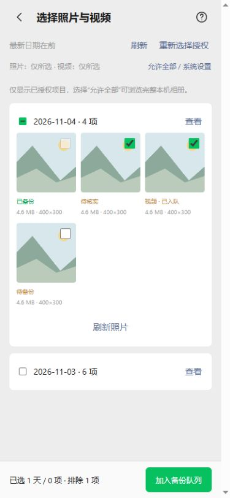
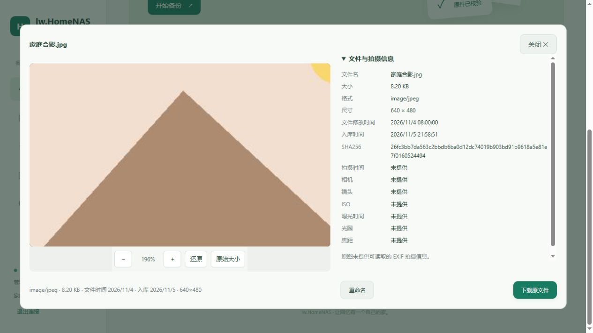
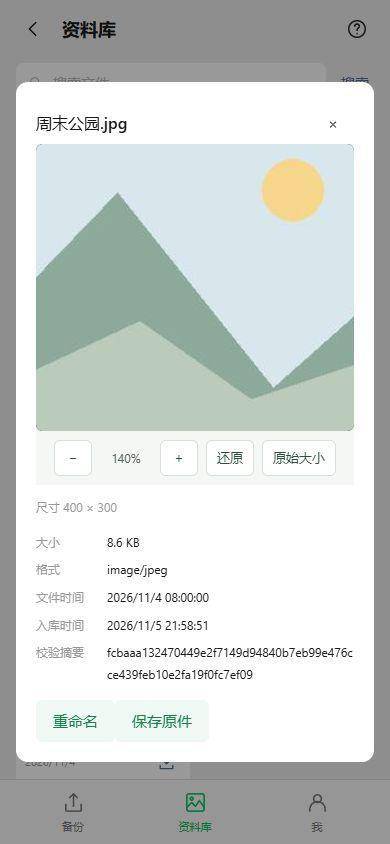

# 选图排除与图片缩放

电脑服务0.4.1-dev，Android源码0.7.2-dev / versionCode12 / nativeApi6，沿用现有固定签名。包含此前的文件重命名，需要通过CI构建新APK。

## 全选以后取消部分

在APK“选择照片与视频”按日期勾选全选后，会自动展开该天照片。未备份照片仍可逐张取消、重新勾选；日期复选框显示半选，底部显示排除数量。点击该天全选可重新选中整天，取消整天则清除当天的单项及排除记录。

选中日期表示该天全部候选，包括还没分页加载的照片；取消单张只记录排除项，不必把整天的缩略图全部加载。刷新该天照片后排除仍有效，刷新整个选择器会开始新一轮选择。已确认备份的照片仍不可重复选择，原有服务端READY校验不变。

原生 `mediaEnqueue` 新增 `exclude_ids`（不透明媒体句柄列表），排除优先于日期和单张选择。入队前解析并验证全部排除句柄，过期句柄拒绝整个操作，避免误传取消的照片。句柄在同轮列表内按媒体身份稳定复用，账号/权限刷新后失效；没有向网页暴露手机URI。保留单轮30天、5000个候选项限制。

## 图片预览

Web与APK图片预览增加放大、缩小、还原和原始大小按钮及倍率显示。放大后可拖动，桌面可用鼠标滚轮、双击，手机实现双指缩放。还原回到适应窗口并居中；重新打开图片也重置。普通视频继续使用播放器控件。

100%表示适应窗口的初始倍率；“原始大小”按原图像素显示。放大只是查看局部，不修改原图或下载内容。两端使用相同PhotoViewer脚本，手机使用较紧凑的视口和固定预览标题，关闭按钮保持可用。

## 验证与升级

真实Windows服务的85项冒烟通过，覆盖新增静态脚本资源；18项Android主机检查、9项发布检查（含20项Node工作流断言）、两端JS语法与31文件Java语法检查通过。选图模型Node回归覆盖整天、单项排除、后续分页、重新勾选和重置，并接入Android CI。

浏览器实测Web放大至196%、拖动及还原；手机页面390×844验证全选、取消一张、刷新保持取消、提交排除及图片140%放大/还原。截图和媒体均为合成夹具，APK原生桥为模拟；新增原生JUnit覆盖稳定句柄、按天排除后真实队列内容、失效排除拒绝入队，待CI执行。本机没有Android SDK，没有编译或安装新APK；双指手势仍需真机测试。

原生协议递增至6是为了让排除项由原生入队逻辑执行。升级先使用新版APK内置界面，保留账号、队列和已备份记录；后续签名页面资源最低要求minNative6。旧APK不能只更新页面来安全实现原生排除。
