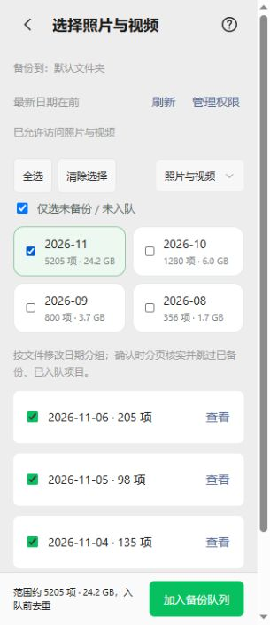

# APK整月选择与并发备份

源码1.1.0，Android versionCode19、原生协议11；包名和固定签名沿用。需要新APK，单独更新网页资源不能提供新原生能力。旧队列、账号、目录偏好及确认偏移保留；队列数据库schema仍为2。

## 使用

选择照片/视频后，可以全选当前媒体类型下已授权可访问的内容，或勾选月份、日期。全选包含未加载分页，可取消月份、某天、某张，也可重新选回已排除月份内的一天。按文件修改日期分组，并非EXIF拍摄月份；未知日期单独显示。切换媒体类型会清空旧选择。

“仅选未备份 / 未入队”默认开启：已确认备份和电脑回收站内容不可重复勾选；排队、上传中项目标记并排除。其他目标文件夹已备份的内容仍可加入当前目录，保留摘要和原件复用。选择栏是范围估计，确认后才按服务端状态统计实际加入、跳过数量。

点“加入备份队列”后异步扫描，显示核对、加入和跳过数量。可点“停止加入”；已加入任务保留，选择规则保留供重试，重复任务由唯一键跳过。切换账号或目录停止旧扫描，已加入任务不会改投新目录。大批入队请保持应用运行；Activity销毁、进程退出或30分钟预算用尽会停止本次扫描，不承诺关闭应用后继续枚举。持久化的任务可继续备份。

备份页“同时上传”提供1/2/3项，默认2项，下次开始备份生效。单文件顺序分块，不同文件并行。所有“已备份”仍要求电脑完整校验并返回READY；摘要读取和发送完成都不代表入库成功。

## 实现边界

- 选择保存规则和排除项，原生每页100项扫描、核实并逐项持久化，不把全部照片放入JS。移除旧5000项总量限制；显式单张选择、排除各限5000个句柄，日期规则各限10000条，浏览句柄保留原5000项上限。
- 确认时枚举媒体ID上界，后续分页受边界限制，避免后续新拍项目滚入同一任务；不把它称为持续变化的MediaStore的跨查询事务快照。分页返回不遵守排序或边界时拒绝继续。源大小/修改时间、权限、身份或目标异常会停止扫描，已入队项保留。
- 一个BackupEngine协调器持进程锁，TaskStore同步领取和标记内存租用，最多3个发送线程，结束必释放。进程死亡不会留下数据库租用；旧线程全部退出后才释放协调器锁。
- 各路RunControl继承父期限，父取消覆盖所有请求及新请求挂接竞争。各文件独立保存摘要、幂等ID、远端任务及服务端确认偏移，重跑查询服务器，旧偏移不算新增速度。
- TransferProgress最多保存3条进行中状态，最近5秒确认字节作为总速度，数据库提供剩余数量/字节。ETA为估计，不承诺提速倍数；摘要、磁盘和Wi-Fi均可能成为瓶颈。

## 验证

本地CMake Windows Release构建通过。隔离服务实测3路各上传5MiB合成JPEG，中途重复同幂等请求恢复偏移，READY后核对原件字节和SHA256，重启服务后仍可读取，3项检查通过；原有smoke86项通过。全部使用测试目录和合成内容，未操作真实资料库。

生产APK控制器DOM回归通过：全选/月选、日期与单张排除、已备份/已入队标记、异步加入与停止、保留选择重试、并发设置、总速度与各文件进度。选择模型Node回归通过，均已接入Android和完整打包CI。

浏览器模拟原生桥检查390×844、320×740布局和选择操作，窄屏无横向溢出，底部操作可用。下图使用模拟数量，不是实际手机速度测量。

新增Android回归覆盖5101项跨页入队、月份/日期排除、扫描中新照片排除、取消保留已入队项、切换目录、异步重复启动拒绝、多线程领取、分路取消及进度隔离。**本机未运行Android JUnit或完整Gradle编译；必须等待新CI的编译、Lint、JVM和设备测试。** 手机需用同批5MB照片比较1/2/3路耗时，并测暂停立即继续、断网、换账号、息屏与目录切换。

本轮不修改签名，不上传代码，不在本机安装Windows服务或修改防火墙。

本地主机检查：Android布局/资源规则23项、发布回归24项、原生依赖284文件及版本/协议/工作流检查通过。
