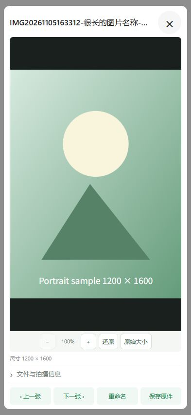

# APK预览布局与PowerShell兼容修复

版本保持1.0.0，APK生产界面有变化，versionCode由14递增到15；固定签名及原生协议8沿用。

## APK预览

截图中照片使用61vh的固定区域，再加标题、缩放栏、元数据和两排操作，整体超过手机可用高度。预览框现按动态视口高度分配空间：标题与底部操作固定，照片区域使用可收缩的剩余空间，ResizeObserver继续计算等比适配和缩放边界。照片与视频都按剩余区域适配。

- 关闭按钮48×48 CSS像素，叉号32px。
- 上一张、下一张、重命名、保存原件保持单行，按钮36px高、12px文字。
- 长文件名省略显示，保留完整可访问名称；加载/错误提示占有界空间。
- 文件与拍摄信息默认收起，展开后仅信息内容独立滚动；头部、缩放和底部操作保留。
- 使用dvh并保留vh兼容值，考虑安全区和低高度横屏，其他设置对话框不套用这一高度布局。

本机浏览器使用生产dialogs.html、style.css及PhotoViewer进行布局验证，样图为合成测试图，没有使用真实资料库。320×568、393×852、740×360三个视口，在元数据收起/展开时均无外层纵向滚动和横向溢出、操作按钮单行可见、关闭区域48×48；缩放至140%、还原、关闭通过。测试夹具与记录存于忽略的test-results/preview-layout，合成样图截图另存docs/images用于说明。完整APK编译、模拟器和真机体验仍需新的CI和手机验证。

393×852浏览器布局示意（合成样图，非真机截图）：

## CI部署检查

[Android CI21](https://github.com/lxw112190/lw.HomeNAS/actions/runs/42130037957)成功；对应[Windows发布流程](https://github.com/lxw112190/lw.HomeNAS/actions/runs/42130808421)在tests/deployment-scripts.ps1生成参数回显EXE时失败。

原因是CI使用PowerShell 7，而旧测试的Add-Type -OutputType ConsoleApplication只在Windows PowerShell 5.1验证过。PowerShell 7.1起不支持这种可执行输出；该错误发生于测试辅助程序生成阶段，不是NAS服务安装失败。

改为使用Windows自带.NET Framework v4.0.30319/csc.exe生成同一无害参数回显EXE，显式检查编译器、退出码和输出文件。继续实际运行EXE，逐项比对包含中文、嵌套引号、末尾反斜杠、&、%等参数，保留服务创建失败回退及精确Win32错误码的断言。build-release.ps1在当前宿主检查之外，再显式调用Windows PowerShell 5.1检查。

两个宿主各20项部署检查通过，没有安装服务、修改防火墙或ACL。20项Android主机检查、14项发布主机回归（含22项Node检查）、版本/工作流检查通过。此次没有跳过失败测试。

完整打包复验采用隔离的CI21提交2c4e99a6107d2583081bcafeb94affb399282a8e源码快照，仅叠加两项部署测试/编排修复并使用已下载的CI21 APK。该复验属于旧code14的本机集成验证，不包含上面的code15新界面，不代表新的云端Release已发布。新界面的完整部署包必须等待对应新CI生成并核验的APK。

复验已完成：Windows Release构建、86项smoke、图集/文件夹/回收站/重命名/时间线检查、两个PowerShell宿主各20项部署检查、CI21 APK固定签名及全部17个内置资源比对均通过。最终ZIP解压后的17项验收也通过，包括离线重复导入、HTTP启动、APK目录与下载摘要、默认管理员登录、FFmpeg封面、图集和原件保留、重启后密码保留。仅使用本机夹具，没有发布远端Release。

本机复验日志为test-results/ci21-rehearsal.log；ZIP位于test-results/ci21/deliveries，SHA256为576d8f38aadd12a9985cf6b3160924d0790029a97a1f4e70acfa4031eb01fefa。测试目录与产物保持忽略，不纳入提交。
