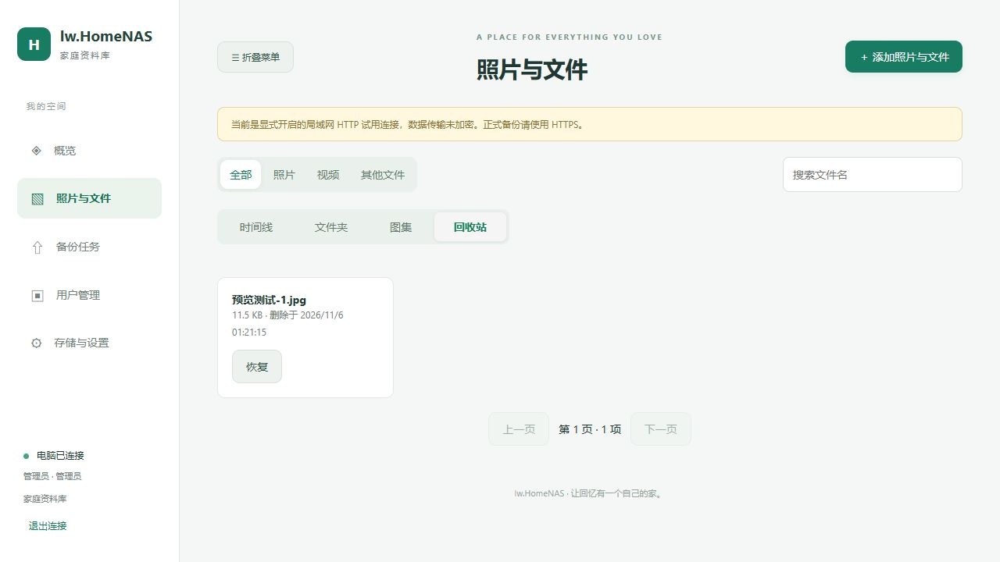

# lw.HomeNAS v1.0.0

> 本文为历史记录。当前流程已改为APK与后台并行构建，见[2026-11-13并行CI说明](20261113-APK与后台并行CI.md)。

本轮将后台和Android版本统一为1.0.0，Android versionCode递增为14，包名和固定签名不变。源码与自动发布流程已准备；实际APK编译、模拟器和GitHub Release状态以本轮提交对应CI为准，不以本机语法检查代替发布验收。

## 图片整理与回收站

Web图片预览新增“移动文件夹”和“移入回收站”。从当前文件夹打开时沿用该来源，在时间线打开且存在多份目录关联时选择可管理的来源，再选择目标。使用现有事务移动接口，只改变指定文件夹引用，其他目录/图集关联及磁盘原件保留。文件夹内原有批量移动入口继续提供。

资料库选择多项后可批量移入回收站。服务端每批1至100项，先核对权限，事务保证整批成功或回滚。普通用户删除自己上传过的内容、恢复自己删除的内容，管理员可管理全部；只读拒绝。资料库共享，移入回收站对所有成员普通浏览生效。

新增asset_trash表记录删除时间与操作人，原件及原目录/图集关联保留。普通时间线、分类计数、图集封面和下载/元数据接口不暴露回收站中的内容；Web回收站可分页、按类型和名称筛选、恢复。删除期间原文件夹被移除时，恢复后至少有默认目录关联。缺失原件仍需独立恢复检查，不伪造成功。

回收站不自动清空，本轮不提供永久删除，不释放磁盘空间。Web首页原件大小包含回收站保留的字节，资料库活动文件数不包含回收站。重新备份同内容仍去重并保留回收站状态；手机来源核对新增TRASHED，选图显示“电脑回收站”，不会作为缺失文件重新入队。

## Web / APK 预览

- 预览以媒体为主，详细元数据默认折叠，展开才读取原图EXIF；没有相机或拍摄参数时不推测。
- 当前已加载页内上一张/下一张，Web支持左右方向键。切换后还原缩放、折叠详情，停止旧视频并丢弃过期元数据响应。
- 保留缩放、拖动、原始大小；桌面滚轮围绕光标缩放。APK图片区域增大，按钮和详情分开。
- APK新增受登录与已浏览asset id限制的assetMetadata桥命令，原生协议/minNative升级8。ClientMaintenance旧协议升级测试前提及模拟器来源状态夹具同步更新；旧下载页面不能遮住新内置界面。
- 视频继续使用设备自身解码能力，封面不等于完整视频转码。

## 日常构建与正式发布

`android.yml`对每次main推送运行签名APK、Lint/JVM和模拟器检查；`release.yml`在可信成功运行后，构建同一提交的Windows后台、验收完整ZIP并上传Actions产物。

新VERSION如1.0.0尚无公开Release时，全部检查通过后先建草稿、上传完整ZIP/独立APK/摘要/manifest，附件完整再公开正式v1.0.0。已有公开版本时继续构建打包，但不新建Release或覆盖旧标签/附件。预发布后缀版本仍标记prerelease；手动运行可关闭publish。

版本主标识是根目录VERSION，check-version.py检查core.hpp、CMake和Android versionName一致。发布并发锁按版本，不按CI序号；发布脚本取自所选提交，保留可信main、APK固定证书、模拟器及产物哈希检查。原ci-*发布不覆盖。

## 部署与文档

继续保留7个BAT，安装跟随配置且默认HTTP；安装日志、原生创建及1783诊断保留。用户在故障Win10教育版执行SFC修复并重启后反馈安装成功；尚未取得具体损坏文件明细，不能扩大为所有1783的通用根因。

README已按安装、使用、权限、升级、编译与CI重写，图片使用相对路径。CMake/VS运行目录复制和完整包只拷贝部署白名单，排除本地日志。保留config/data，不重置已有密码。

## 验证记录与发布状态

本机已完成CMake和直接VS2022 Release/x64编译；86项原生冒烟、73项回收站检查（含49项入库后的分页测试）、22项文件夹、14项重命名、13项图集、9项时间线、13项媒体预览检查通过。20项Android主机检查、10项发布主机检查（含22项Node发布分支及版本/协议一致性检查）、20项部署诊断、32文件Java语法及服务/防火墙计划检查通过。协议8签名页面资源的实际生成与16项维护接口往返检查通过。

真实浏览器已验证图片切换、折叠/展开EXIF、单图移动、站内删除确认、回收站隐藏和恢复。测试仅使用本次独立测试库中的合成图片。没有安装服务、改变开发机防火墙或访问真实手机相册。

真实0.4部署程序建立的资料库和未完成上传升级到1.0的9项检查通过，保留账号/服务器身份/原件/确认偏移，并可继续完成上传和使用回收站。0.1专用迁移测试需要独立0.1 EXE，本轮未重跑；现有目录旧表迁移另由文件夹专项检查覆盖。Android新JVM/仪器测试、签名v1.0 APK及完整CI部署ZIP仍需提交后验收；尚未对外发布v1.0 Release。旧版APK不能伪装为新版本装入正式包。
