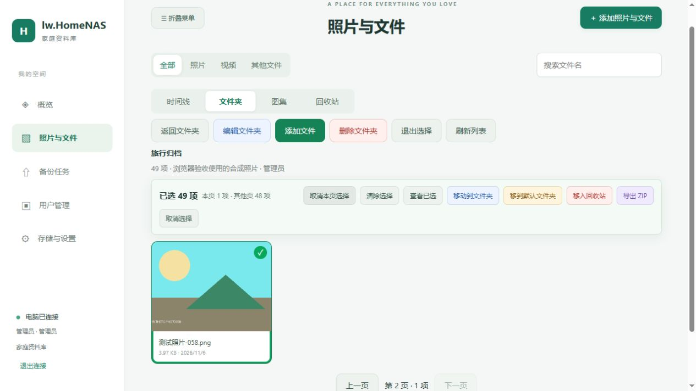
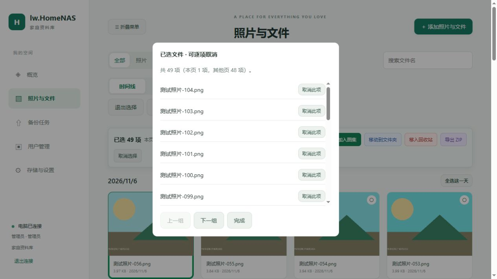

# 跨页整理与手机目标目录修复

源码 1.1.1；Android versionCode20 / nativeApi12，固定签名保持。未自动提交、推送、创建标签或发布；APK由后续CI构建。

## Web 整理

- 在相同展示位置、文件类型、搜索和账号下，翻页保留全部勾选。操作栏明确显示总选择、本页和其他页数量；“全选本页”变为“取消本页选择”时只影响本页。
- “查看已选”列出跨页选择，每组20项，可逐项取消；选满1000项有明确提示。
- 改变搜索、文件类型、位置或账号时清除旧选择。加载中的旧卡片不接受误点，过期响应不会覆盖新条件，取消选择不会卡住正在请求的下一页。
- 时间线批量移动先请求共同来源：唯一来源自动采用，多个来源明确选择，没有共同来源时提示按来源移动或加入文件夹。目标列表排除来源本身。
- 加入图集检查全部选中项，包含其他页的非照片/视频时在写入前拦截。删除、恢复、永久删除的确认包含本页/其他页数量。
- 每100项提交，只有得到成功响应才从已选集合中移除；失败保留未确认项。成功操作优先留在当前页，删空最后一页时回到有效页面。
- 分页可用状态由游标数据统一管理；批量结束不能恢复旧的 disabled 值，把第一页的“上一页”错误启用。

## 手机选择目标后仍上传到旧目录

发现的具体逻辑：MediaPicker 虽优先寻找当前目录任务，但找不到时会使用同一照片在其他目录的记录；原逻辑直接把该记录的 QUEUED / HASHING / UPLOADING / VERIFYING / COMMITTING 状态当作当前目录已入队。“仅选未备份/未入队”默认开启时会跳过它，新目录没有产生任务，而队列中的旧任务照常上传。

修正为目录内去重：其他目录的非完成任务返回 OTHER_FOLDER，选图中标明“其他文件夹有任务，可在此备份”，允许为当前目标创建独立任务。当前目录已有任务继续去重；已备份记录仍向电脑核对 in_folder，不凭全局 READY 跳过新目录。

补齐自动相册扫描和系统文件选择的账号/目录变化检查，中途改变后停止继续入队；已提交的批次、任务ID和确认偏移保留。更改目标不重定向已经排队或上传中的旧任务。

入队任务冻结并回传 folder_id / folder_name；进度、结束提示和每个上传文件显示实际目标。原生任务保持 folderId，创建服务器上传仍发送该字段并核对返回值。诊断仅记录目录ID与任务ID，不增加文件名、媒体内容、凭据或 URI 日志。

安装 code20 或更新APK后再验证：选目标文件夹 → 重新进入选图 → 确认顶部目标 → 加入队列 → 查看每项实际文件夹 → 开始上传。原件可有多个逻辑文件夹关联；新目录的备份不会自动移除已有旧目录引用。图集与文件夹概念的收拢仍是独立产品讨论，本轮没有迁移分类数据。

协议/minNative升为12，旧的已下载界面不遮住新增状态和目录提示，继续使用已配置的签名身份。此次包含原生逻辑变更，仅更新 HTML 不能完整获得修复。

## 验证范围

- Windows CMake Release 构建及运行目录 Web 同步通过。
- 生产控制器与生产 Web 分页代码的 DOM 回归35项：跨页勾选/取消/清单、筛选切换、过期响应、目录内移动、末页删除及按钮禁用、1000项边界、部分失败和只重试剩余项、跨页非照片拦截、账号切换取消等。保留原有205项按天跨页、图集成员、ZIP及文字确认测试。
- 隔离真实服务：资料库82项、文件夹22项、回收站92项、smoke86项通过，包含新预检的权限、混合来源、过期选择、1000项请求大小与原件字节验证。所有测试数据均为合成文件。
- 实际浏览器使用105张生成照片，完成49项跨页选择、清单查看、移动、目录内跨页回收49项、回收站跨页恢复49项；恢复后目录仍含49项，空列表两侧分页按钮正确禁用。截图不含真实资料库文件。
- 实际 APK 页面 + 模拟原生桥：切换目标到“旅行”后重新选图，提交的新 folder_id 与显示目标一致，OTHER_FOLDER 可选、同目录 READY / QUEUED 仍禁选，入队和每文件进度显示实际目录。模拟桥通过不代表Android真机通过。
- Android主机检查23项、发布主机检查24项、Java语法42个文件通过。新增 Robolectric 用例覆盖五种旧目录待上传状态、新目录入队、同目录去重、自动扫描在切换目录/账号后停止、两路上传分别显示目录；这些 JVM 用例、Android完整编译、Lint、模拟器和真机结果需等待新CI，不在本机安装SDK或宣称已通过。

本地测试证据存于忽略的 test-results，不把测试数据库、日志、凭据或照片打进交付包。
