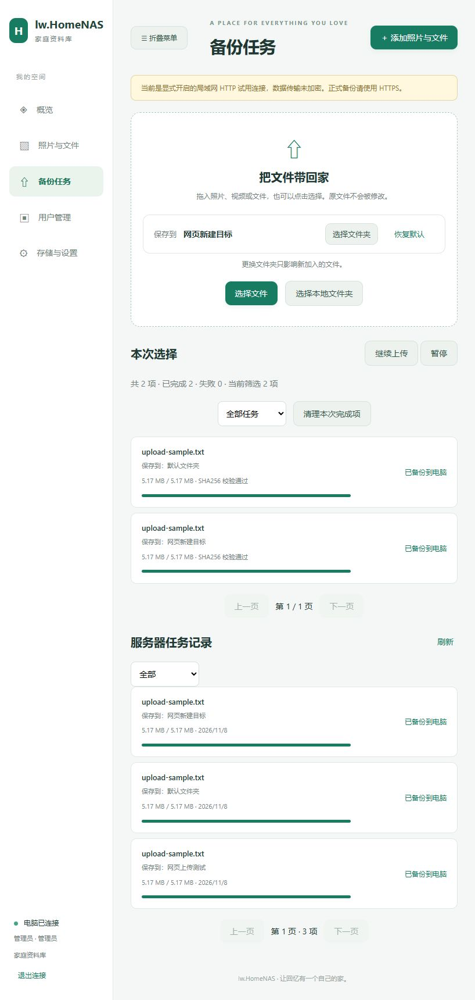

# Web上传时选择目标文件夹

日期：2026-11-08。修改Windows后台与Web，不修改APK、签名、原生桥协议或资料库结构；沿用现有文件夹接口及权限。

## 使用

1. 点页面右上角“添加照片与文件”或首页“开始备份”，进入备份任务。
2. 在“保存到”选择文件夹。列表可继续翻页，只显示当前账号可写的目标，支持新建后直接选中。
3. 点“选择文件”或“选择本地文件夹”，也可把文件拖入上传区。未选择目标时使用默认文件夹；“恢复默认”可切回。
4. 已加入的每条任务保留原目标，继续/重试不会使用后来选中的目标。任务和服务器历史记录展示保存位置。

## 行为细节

- 文件夹属于共享资料库中的逻辑分类。不会把电脑路径传给网页，也不会复制同内容原件来模拟不同目录。
- 当前队列按“文件来源信息 + 目标文件夹”去重；同一文件在不同文件夹可分别加入。创建任务的client_task_id同样包含非默认目标，source_key保留原来源信息，避免幂等任务绑定旧目标。
- 每批选择在入队前冻结目标，分批整理期间改选目标也不会拆散原批次。
- 上传请求显式发送folder_id，并核对服务端原目标和有效目标回执；目标被删除时只接受服务器明确返回的默认回退，任务保留提示。未经确认的错误目标停止处理，不能显示成功。
- 账号退出/登录清空选择并使用默认目标，旧文件摘要与旧选择窗口的异步结果不能给新账号创建任务。原有队列仍是网页前台队列，刷新页面需重新选择文件，服务端确认偏移可继续复用。
- `/tasks`和`/tasks/page`补充folder_id、effective_folder_id、folder_name、folder_defaulted。使用有界列表的LEFT JOIN，不逐条查全量目录，保持成员任务隔离、过滤和游标。网页连接旧后台未返回目录名时不猜测历史目标。
- 旧APK不受新增响应字段影响，无需为本功能重新安装APK。请同步更新NasServer.exe和web目录，后台历史记录才能显示目录名。

## 验证

- Windows Release增量编译及运行目录web同步通过。
- Web生产上传函数+DOM：默认/选择、跨目录重复加入、冻结205项批次、重试原目标、删除目标回退、错误回执、账号变更及过期选择结果通过。生产资料库分页控制器35项与图集DOM回归通过。
- 实际Windows隔离服务：文件夹27项、smoke86项通过；10001条文件和10001条任务分页通过，包含成员隔离和任务目录元数据。
- 实际浏览器：登录隔离测试服务，将约5MiB合成文件上传到已有文件夹、默认目录和网页新建目录，三个任务均READY；核对三处目录关联、历史目录名称、一个去重原件以及下载原件与上传文件逐字节一致。
- 发布构建脚本接入Web上传目录回归。测试不读取或修改用户真实资料库，不对外发布；没有声称完成新APK或安卓真机测试。

本机证据保存在忽略的test-results。截图使用隔离合成数据。
