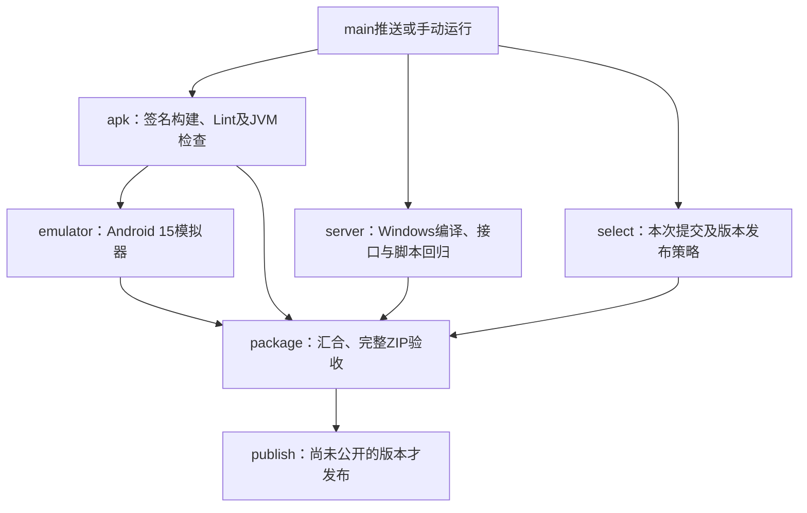

# APK与后台并行构建

主入口为 `.github/workflows/android.yml`，显示名称 **Build APK, server and Release**。保留该文件以延续原Android CI编号；原来等待Android工作流完成才触发的 `release.yml` 已合并。本次只修改构建流程，VERSION仍为1.2.0，APK保持code22/nativeApi13开发状态及原固定签名。

## 执行流程

`apk` 和 `server` 没有相互依赖，分别在Ubuntu和Windows Runner运行。实际总时间取决于较慢的分支、Runner排队和最后打包，尚未实测云端节省分钟数。

## 下载什么

| Actions Artifact | 内容与用途 |
| --- | --- |
| `lw.HomeNAS-Android-N` | 固定签名Debug/Release APK、生成的输出元数据与SHA256；正式APK短名为 `HomeNAS-版本.apk` |
| `lw.HomeNAS-server-ciN` | 不含APK的Windows独立后台ZIP、SHA256与 `server-build.json`；可用于只部署后台 |
| **`lw.HomeNAS-full-ciN`** | **推荐日常部署**；完整后台ZIP内附 `client-release` APK及可选签名资源，还附独立APK、摘要、发布清单及说明 |
| `Android-*-reports-*` / `Windows-*-checks-*` | 失败诊断与自动检查证据，不是安装包 |

单个分支成功即可下载该分支产物，即使另一个分支失败。完整包必须等到APK、后台、模拟器及版本规划任务均成功。重新运行失败任务可复用本次运行中其他成功任务的产物；Artifact已过期时需重跑全部任务。上传使用同名替换以支持同一次运行重试，不改写公开Release附件。

## 后台只编译一次

`tools/build-server-release.ps1` 完成原有的依赖校验、主机回归、页面DOM检查、CMake编译、接口回归和两种PowerShell宿主下的部署检查，然后生成独立后台ZIP。

`tools/server-artifact.py create` 为ZIP记录提交、CI编号、版本、ZIP和已测试EXE的SHA256。EXE必须等于测试使用的 `build/app/Release/NasServer.exe`，FFmpeg原始字节必须匹配源码中的锁定清单。

最终 `tools/build-release.ps1` 必须取得APK和后台两份产物。它恢复已校验的EXE及固定FFmpeg，依赖只运行 `--verify-only`，不重复编译、不重复联网下载。只恢复白名单运行文件，不把ZIP中的配置、未知路径或私人数据写进工作区。随后继续验证真实APK签名/源提交/页面/版本、制作完整包，并在解压后核对EXE摘要及运行完整ZIP验收。完整包清单记录来源后台ZIP和EXE摘要。

## 发布与手动运行

- main每次推送运行两条分支。VERSION已公开时仍生成CI包，不覆盖已有Release；尚未公开时，全部门禁通过后按原规则从附件齐全的草稿发布。
- 在main点 **Run workflow**，默认 `emulator=true`、`publish=true`。
- `publish=false`：仍运行模拟器和完整包验收，只不公开Release。
- `emulator=false`：只生成独立APK和后台包；模拟器、完整包和发布链路不会被绕过。
- PR运行源码编译/检查及后台回归，不分发签名APK、不生成完整发布。其他分支手动运行也不分发正式APK或Release。
- 不再提供选择历史Android run ID的入口；所有构建固定当前事件SHA，产物只从同一次workflow读取。签名Secrets保持原配置，UI签名Secret仍可选。

## 验证范围

本机35项发布工具回归（另含24项Node假API断言）、23项Android主机检查及工作流结构/版本检查通过。新增回归覆盖两条构建分支无依赖、完整包等待全部门禁、同一次运行下载、产物跨提交/编号/版本拒绝、ZIP/EXE/FFmpeg篡改及路径拒绝。

已实际执行新的后台构建脚本并生成Windows独立ZIP，原有接口、DOM及双PowerShell宿主部署检查全部通过；随后将真实ZIP恢复到另一个隔离目录，核对EXE逐字节摘要、实际运行 `--version` 和全部FFmpeg固定摘要，确认无二次编译。隔离证据位于忽略目录 `test-results/server-handoff-pass.json`，本机模拟CI编号900013仅用于验证，不是线上CI或发布版本。不安装服务或修改防火墙。

新的GitHub工作流调度、签名APK构建、Robolectric与模拟器以及同提交完整APK+后台ZIP验收，仍需用户提交推送后在CI运行。本机结构检查不能代替GitHub实际接受与运行，后台独立ZIP也不代表完整包已发布。
