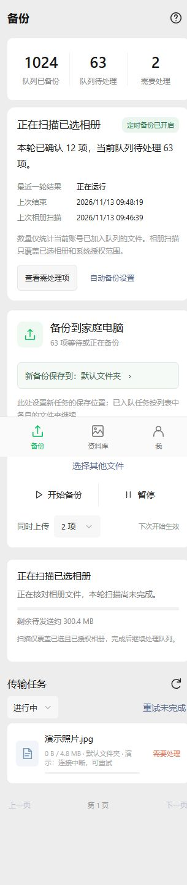

# 备份中心与APK短文件名

日期：2026-11-13。基于已发布v1.2.0开发，APK code22、nativeApi13，固定包名/签名不变，版本名称暂为1.2.0。提交后先由CI生成新测试产物；已有公开v1.2.0附件保持不变。

## 手机备份中心

- 首页显示最近一轮结果、上次结束时间和上次完成相册扫描的时间；记录按账号scope隔离，存储在本机，不含文件名、账号明文、令牌或错误正文。
- 原有成功/等待/失败数量标明“队列”，仅覆盖当前账号已加入的文件，不能当作整部手机的备份完整率。相册扫描范围同样受所选相册和授权限制。
- 运行状态区分准备、扫描、摘要、发送、电脑校验；扫描中使用不确定进度，不显示虚假的扫描百分比或“0项进行中”。
- 空闲时显示手动备份、暂停、等待网络/非计费网络/充电/电量、未选择相册等状态。条件满足只代表允许系统调度，不保证15分钟准点执行或立即唤醒。
- 普通结束但队列仍有错误/待处理时记录ATTENTION/PARTIAL，不显示全部完成。进程终止后仍留RUNNING的记录，在下次读取时显示INTERRUPTED。
- “查看需处理项”切到失败任务第一页；“自动备份设置”直接打开相册设置。原有重新排队、开始/继续、暂停、续传和目标目录规则保留。
- 默认定时批次仍受两分钟预算约束，先清理旧队列再扫描的调度方式本轮未改变；后续可单独做增量扫描与扫描检查点，不能把本轮状态面板称为已解决后台调度或扫描饥饿。
- 协议升至13，防止旧下载资源覆盖备份中心；ClientMaintenance升级/回退测试前提同步调整。无需迁移任务数据库。

## APK命名

- CI Artifact中的Release为 `release/HomeNAS-1.2.0.apk`，Debug为 `debug/HomeNAS-1.2.0-debug.apk`。
- 正式Release附件使用 `HomeNAS-版本.apk`。电脑ZIP和Artifact容器本轮不改名。
- 保留CI编号、提交SHA、versionCode、摘要和固定证书核验，软件诊断区也显示code/CI。仅重命名签名后的文件，不重签、不修改APK内容。
- 重命名工具同步Gradle生成的output-metadata.json；摘要清单在重命名后生成，打包器读取实际文件名并核对摘要，兼容旧Artifact的app-release.apk。
- 内容寻址的内部维护文件仍按SHA256保存；网页登录下载通过Content-Disposition给出短名称，无需修改API或旧APK下载URL。

## 验证

- 备份中心DOM覆盖统计范围、空历史、扫描/摘要/发送/校验、暂停、中断、等待条件、失败入口和只读/退出；既有APK选图/并发进度与图集DOM回归通过。
- 实际内置HTML/CSS/JS加模拟桥的浏览器验证暂停/扫描、失败入口、自动设置入口，320px窄屏及740px横屏无横向溢出。模拟桥通过不等于实际Android运行。
- 23项Android主机检查、27项发布工具检查、工作流结构与22项发布流程断言通过。新增Robolectric覆盖持久历史、跨账号隔离、中断、策略及损坏设置，实际执行须等待CI。
- Windows后台编译、启动自动发布及短文件名下载回归由本轮本机隔离服务验证；没有在开发机安装服务或修改防火墙。
- 本机没有Android SDK；新APK的javac、JUnit/Robolectric、模拟器、固定签名及完整ZIP验收待本次推送后的CI。未新增开发依赖来把语法解析替代Android编译。
