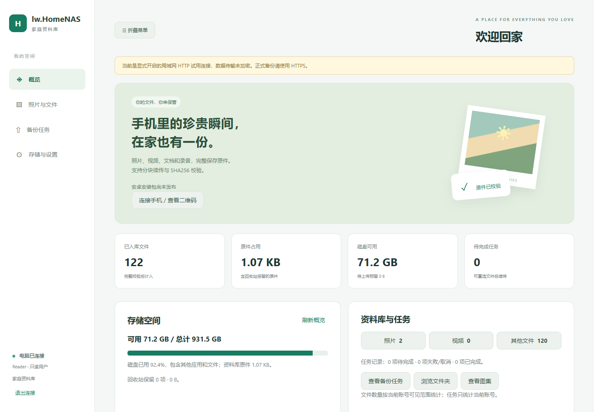
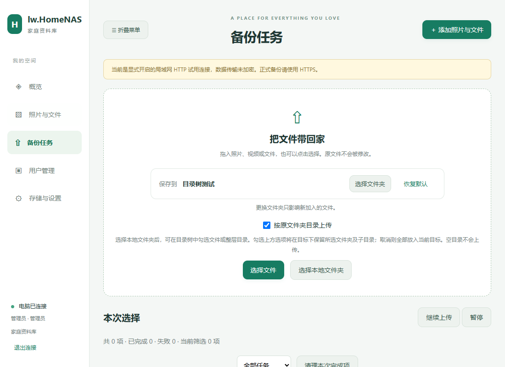
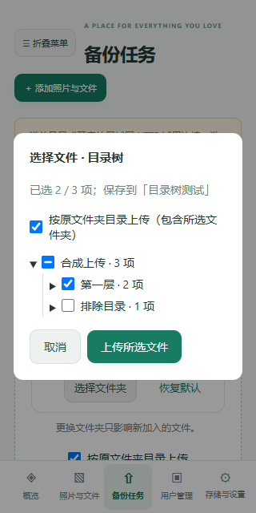
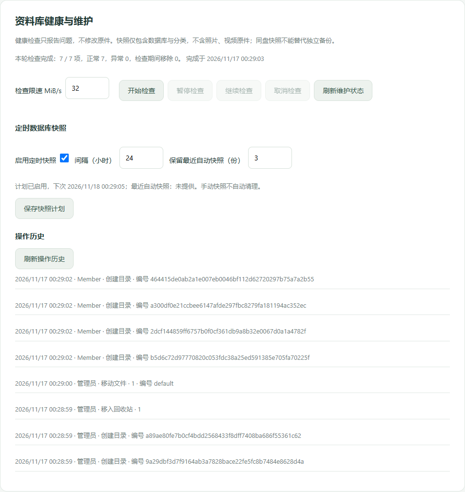

# 把闲置电脑变成家庭照片备份站：开源 lw.HomeNAS v1.5.0 发布

手机里的照片越来越多，孩子的成长记录、旅行视频、家人的合影，还有随手保存的各种文件……时间久了，手机空间不够用，整理和备份也成了一件拖延很久的事。

如果家里有一台闲置的 Windows 电脑，能不能用它来保存这些资料，让手机上传、电脑整理、浏览器查看？

这就是我开发 **lw.HomeNAS** 的初衷：**自己的电脑做服务器，把手机照片和视频备份到家里。**

现在，**lw.HomeNAS v1.5.0 已经发布**。这一版除了改进上传和浏览体验，还加入了资料库健康检查、定时数据库快照和操作历史，让资料存进去之后，也更方便检查和维护。

*Web 概览集中展示文件数量、存储空间和常用入口。文中截图来自测试资料库，文件、统计及服务状态仅用于功能演示，不代表发布包的初始状态。*

## 一台 Windows 电脑，一个家庭资料库

lw.HomeNAS 是一个开源的家庭备份与文件管理项目，目前提供：

- **Windows 服务端**：负责存储文件，可以安装为 Windows 服务，随系统启动。
- **Web 管理页面**：通过浏览器上传、查看、搜索和整理资料。
- **Android 客户端**：选择手机照片、视频和文件，上传到家里的电脑。

目前的目标平台是 Windows 10/11 x64 和 Android 10 及以上。第一次使用，建议先让手机和电脑连接到同一个家庭局域网。

除了照片、视频，也可以保存文档、录音和其他文件。存储空间取决于电脑上的硬盘，原件保存在自己的设备上。

## 从“存进去”，到“以后找得到”

备份之后，能不能方便地找到资料，同样重要。

lw.HomeNAS 支持多级文件夹和照片时间线。日常可以按照年份、家庭成员或用途整理，也可以通过图集，把不同文件夹里的照片归到同一个主题中，不需要再复制一份原件。

例如，文件夹按年份保存照片，再创建一个“孩子的成长”图集，就能把不同年份的照片放在一起浏览。

上传已经整理好的电脑文件夹时，可以勾选 **“按原文件夹目录上传”**。像“旅行 → 第一天 → 照片”这样的层级，会在资料库中保留下来。

*保留原目录结构，减少上传后重新分类的工作。*

上传前还可以通过目录树选择需要的内容：展开子目录，勾选单个文件或整层文件夹，也可以排除不需要的内容。

*目录树选择也适配窄屏浏览器，支持逐层展开和勾选。*

搜索会跟随当前位置：

- 在主目录搜索，查找当前账号有权访问的全部文件。
- 进入某个文件夹后搜索，查找该文件夹及其子目录。
- 进入某个图集后搜索，只查找这个图集中的文件。

不用每次都面对一大堆无关结果。

## v1.5.0：增加资料库健康检查

文件上传成功之后，保存一段时间是否仍然完整？有没有原件缺失、大小异常，或者内容发生变化？

这一版在管理员的 **“存储与设置 → 资料库健康与维护”** 中加入了健康检查。

它可以检查原件是否存在、文件大小和 SHA256 摘要是否一致，以及目录关联、已生成缩略图的存在情况。发现异常后，可以在页面查看结果、导出当前页异常清单，再进一步处理。

检查支持限速、暂停、继续和取消，方便根据电脑的使用情况安排。

**健康检查只报告问题，不会自动修改或删除原件。** 它帮助我们了解资料库的状态，也让后续维护有据可查。

*v1.5.0 新增维护页面。图中展示一次检查完成后的状态，以及自动快照配置和操作记录。*

## 定时快照与操作历史，让维护更有条理

照片之外，资料库里还有账号、文件夹结构、图集和配置。这些整理成果也需要保存。

v1.5.0 新增了 **定时数据库快照**。管理员可以按需要开启，设置生成间隔和自动快照的保留数量。服务运行期间会按计划生成快照，清理过期自动快照时，也会保留手动创建的快照。

这里需要区分：**数据库快照保存的是资料库的管理信息，不包含照片、视频等原件。** 重要资料仍建议在另一块硬盘或其他设备上保留独立副本。

同时，新版加入了 **操作历史**。目录、图集、改名、回收站、权限调整等操作，都可以由管理员查看记录。

家里多人一起使用时，遇到“文件夹怎么换了位置”“权限什么时候调整过”之类的问题，就多了一条排查线索。

## 上传与浏览，也打磨了一批细节

这一版修复了多项上传、搜索和账号切换中的边界问题，包括长中文目录上传、文件名包含特殊字符时的搜索，以及同名、同大小但内容不同的文件入队识别。

上传过程中，现在可以看到目录整理进度，也可以取消后续整理。出现部分失败时，支持 **只重试失败项**，并导出失败清单，方便逐项处理。

文件浏览新增了列表与网格布局，可以按名称、修改时间和大小排序。预览时可以查看完整来源目录，并直接打开所在文件夹。

图集支持恢复自动封面；移动文件夹、调整层级之前，也可以预览成员权限的变化。

这些改进不一定一眼就能看到，但在文件越来越多、目录越来越复杂时，会直接影响日常使用是否顺手。

## 给家人使用，也能分开管理

lw.HomeNAS 提供管理员、普通成员和只读账号，并支持按目录授权。

可以为每位家庭成员建立自己的目录，再按需要共享旅行照片、家庭视频或公共资料。新建一级目录默认仅所有者可见，管理员仍可管理全部资料。

普通删除会将文件移入回收站，方便误操作后恢复；回收站不会自动清空。服务端删除文件，也不会连带删除手机里的原文件。

上传采用分块传输，并支持暂停、继续和失败重试，入库前会进行完整校验。照片、视频按原件保存，不强制压缩或转码。浏览器上传时需要保持页面打开，刷新后需要重新选择相同文件才能继续。

## 怎么开始使用？

准备一台有足够硬盘空间的 Windows 电脑，按下面几步就可以开始体验：

1. 从发布页下载并完整解压 Windows 发布包。
2. 双击根目录的 `启动服务.cmd`，保持运行窗口打开。
3. 在电脑浏览器中访问 `http://127.0.0.1:8787/`，首次登录后修改默认密码。
4. 手机访问电脑对应的局域网地址，从网页登录页下载 Android 客户端。
5. 在 App 中填写服务器地址、登录账号，选择照片或文件开始备份。

确认使用正常后，可以通过发布包中的脚本安装为 Windows 服务，方便开机自动运行。

电脑需要保持开机、服务运行且网络可达。Android 自动备份会受到系统权限、省电策略和后台调度的影响，建议通过备份中心确认任务完成情况。

## 开源地址与下载

如果你也希望用自己的 Windows 电脑管理家庭照片、视频和文件，欢迎下载体验。

**项目源码：** [lxw112190/lw.HomeNAS](https://github.com/lxw112190/lw.HomeNAS)

**版本下载：** [lw.HomeNAS Releases](https://github.com/lxw112190/lw.HomeNAS/releases)

项目会继续围绕备份可靠性、资料整理和日常使用体验改进。欢迎在 GitHub 提交问题、分享使用场景，也欢迎 Star 支持。

希望 lw.HomeNAS 能让那些留在手机里的珍贵记录，在家里多一份妥善保存的副本。
