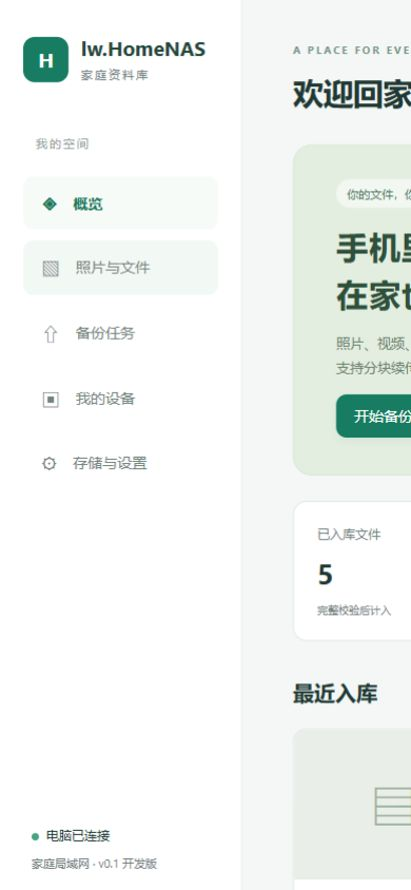
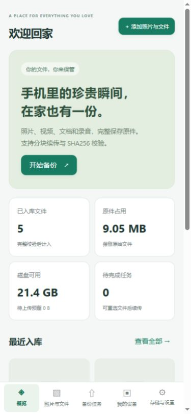

# 2026-11-04 首版开发记录

2026-11-06 CI20部署包修复：云端Android APK及模拟器成功，但release.yml因重复ref和select自引用在配置阶段失败、无Windows任务。修复checkout作用域，新增严格重复键/任务依赖检查和回归；Android前置显式安装PyYAML并检查所有工作流。14项发布回归、20项Android主机检查通过；保持1.0.0/code14，不跳过模拟器或改写旧发布。需提交后新CI验证。[记录](20261106-CI20部署包工作流修复.md)。

2026-11-06 v1.0.0准备：用户反馈SFC修复并重启后服务安装成功。新增Web单图移动与单项/批量回收站、按删除时间分页筛选和恢复，保留原件与分类；Android识别TRASHED不重入队。Web/APK预览加入当前页切换、元数据按需读取、旧播放/响应清理，原生协议8，APK code14固定签名。CI每次main推送构建打包，仅未发布的VERSION生成版本标签正式Release；已公开版本不覆盖。README重写，本机原生/API/浏览器/主机检查通过；新APK及完整包待同提交CI，未推送或发布。[发布准备与验证范围](20261106-v1.0发布说明.md)。

2026-11-06 安装诊断r3：用户确认原生与系统sc.exe均返回1783，r2未解决目标机问题。新增默认只读的diagnose-service.ps1，显式-ProbeCreation可做虚拟账号/LocalService禁用临时服务对照；不启动，按创建返回句柄清理，报告保留错误和清理结果，不改变正式身份或安全策略。20项非安装检查及7入口计划通过，未在开发机执行创建探测；目标机JSON待用户反馈。[记录](20261106-服务安装诊断与七个部署入口.md)。

2026-11-06 安装脚本r2：目标Win10教育版的新日志显示CreateServiceW 1783（RPC_X_BAD_STUB_DATA）。复核原生接口签名后未发现不匹配，根因仍未确定。仅对1783且确认服务不存在时，增加同虚拟账号/路径的sc.exe单次兼容尝试，记录双路径结果；不修改系统策略或身份。新增真实Windows argv回显和生产安装函数测试适配器分支回归，16项诊断检查及服务计划通过，未在本机或故障电脑实际安装本轮服务。[记录](20261106-服务安装诊断与七个部署入口.md)。

2026-11-06 服务部署打磨：Windows10教育版创建服务返回WMI代码8，程序尚未启动而无service.log。改为Unicode原生CreateServiceW并保留Win32原码，增加独立轮转安装日志/临时目录回退和阶段记录；保留虚拟账号、NULL密码、同名拒绝和数据。参考PPOCR脚本加入失败恢复。按用户要求最终只保留7个BAT，不增加菜单；状态/导入/密码等使用PowerShell。打包及runtime复制白名单排除日志，加入诊断及入口回归。未在故障机器或本机实际安装新服务。[修改与验证边界](20261106-服务安装诊断与七个部署入口.md)。

本文保留0.1历史记录。当前0.2已改为账号权限并提供Windows服务部署脚本，见[账号权限与服务部署](20261104-账号权限与服务部署.md)；当前验证结果见[验证结果.json](验证结果.json)。

版本：0.1.0-dev。目标：先完成 Windows 电脑与手机网页的前台备份闭环，自动备份留给下一阶段的 Android 专用 Runtime。按用户要求，本地仓库已经初始化为main、配置origin；没有执行git add、commit或push。

实现：C++17 / VS2022直接方案与CMake双入口，静态链接SQLite与Mbed TLS；本机HTTP+局域网HTTPS；管理登录、设备配对/撤销、共享家庭资料库；上传会话、顺序块、大小/摘要校验、容量预留、原件入库和范围下载；同内容去重与不同内容同名保留；WIC缩略图。

恢复验证包含：确认偏移持久化、未确认尾部截断、入库移动完成但数据库尚未提交的恢复、缺失原件不会返回假成功。8种EXIF方向与Pillow图像参考对照，修正了WIC中镜像旋转5/7的组合顺序。

网页验证使用独立测试库及自动生成的图片/随机二进制/文档，不使用私人相册。浏览器批量上传5个文件，其中随机文件超过默认8MiB块大小；全部入库，照片筛选与原图预览通过。1366×900与390×844视口未发现横向溢出，截图使用相对路径：

首版不包含：实际APK、Android相册扫描/后台上传、成员私有空间、Windows服务安装/开机启动、视频封面/转码、第二硬盘副本、外网访问。本机访问和手机网页前台访问已经具备，Android真机尚未验证。

0.1当时的包内自动检查为57项。实际4GiB以上文件的完整上传、锁屏、省电/强制停止、真实磁盘断电等仍需后续专项测试；当前不承诺任何速度指标。

2026-11-04 0.2.5：新增大批上传优化、游标分页、两端页面拆分、安卓独立登录/底部栏和默认APK签名资源r2，详见[本轮记录](20261104-大批量备份与页面拆分.md)。Android 0.5原生源码待CI，不替换已核验的默认0.4 APK。

2026-11-04 CI修复：拆分安卓HTML后，旧check-android.py仍断言connect-src none，导致构建前检查失败。现按真实架构要求connect-src self，仅允许WebViewAssetLoader同源HTML读取；检查boot.js及各views片段存在，并保留其他CSP限制。增加7项布局/CSP回归，与原3项模拟器证据脚本测试合计10项本地通过。工作流同步运行两组测试；未在本机编译Android，需提交后重新运行CI。以后调整CSP、资源入口或页面结构时同步执行tools/check-android.py及这两组测试。

2026-11-04 接收CI5：核验0.5.0-dev / code6 APK，作为新部署包默认；签名与CI3不同，覆盖升级限制及保留待上传任务步骤见[CI5部署说明](20261104-CI5安卓安装包发布.md)。APK完整性验证不代表设备功能验收。

2026-11-04 安卓简约资源r3：重做登录/备份/资料库/我的页面，说明移入帮助与折叠设置。修复定时刷新跳顶，保留旧桥降级及所有原生能力；签名资源兼容CI3/CI5，不重新打包APK。[预览与验证](20261104-安卓简约界面r3.md)。

2026-11-04 资源r4修复：诊断定位到许可证TXT被APK解包白名单拒绝。将许可证保留全文转为HTML，增加与已分发Java规则一致的打包/CI前置校验和14项回归。原样Java解包循环桌面复现r3失败、r4成功，原APK保持不变；真机激活待复测。[详细说明](20261104-资源解包失败与r4修复.md)。

2026-11-04 0.3.0 / Android 0.6.0-code7：时间线索引与游标、账号归属备份状态核对、按天选图、媒体流式预览和紧凑保存入口完成；待用户 CI 编译新 APK 后再打包。打包默认允许外部 Host，首次 admin/admin123，已有密码保留。修复旧库升级测试夹具携带新字段导致真实 0.1 程序拒绝启动的问题，13 项重新通过。[功能、限制及验证](20261104-时间线与按天选图.md)。

2026-11-04 CI7：接收并核验 Android 0.6.0-dev/code7，默认 APK 更新为 CI7，签名资源 r5。部署包默认外部 Host 开启、首次 admin/admin123，已有账号不重置；Debug 证书与 CI5 不同。按用户要求补充 CI 固定 Debug 签名支持，复用已有持久 JKS Secrets，等待用户配置与后续 CI 验证。[发布说明](20261104-CI7安卓安装包发布.md)。

2026-11-04 0.3.1 / Android 0.6.2-code9：修复 MediaStore 混合查询排序可能丢新日期、授权返回后未刷新、MKV/AVI MIME 被原生代理拒绝；增加独立 FFmpeg 视频封面、WIC EXIF 详情、上传速度和阶段反馈、列表局部更新、底部选择面板与灰色输入焦点、播放诊断和轮转策略显示。原生/浏览器验证通过，Android 新增回归待 CI。[功能与边界](20261104-相册权限与媒体预览优化.md)。

2026-11-05 CI编译修复：DiagnosticsTest使用Files.readString，Android API桩没有该方法，导致compileDebugUnitTestJavaWithJavac失败。改用Files.readAllBytes加UTF-8解码、StringBuilder汇总，保留完整轮转断言。增加不可用Files字符串API的主机检查和3项回归，现有工作流会在Gradle之前执行；18项主机检查通过。JDK17及Java11语法配置不能替代Android API兼容检查。当前修复未在本机编译Android，需要推送后重新跑CI；失败构建未发布APK，继续使用0.6.2/code9。

2026-11-05 CI9：收到并核验 0.6.2-dev/code9 APK，14个内置页面与源码匹配；默认分发更新至 CI9/r6，完整包附带已实测 FFmpeg 7.1 及其版本、许可、来源记录和上游源码归档。证书与 CI7 不同，不可直接覆盖；首次 admin/admin123、外部 Host 开启，已有密码保留。[发布说明](20261105-CI9安卓安装包发布.md)。

2026-11-05 0.3.2：将局域网 HTTP 加入 allow_insecure_lan 配置并默认 true；前台/服务统一使用可选命令行覆盖，保留正向参数并增加反向参数。HTTPS 配置脚本显式关闭内网 HTTP。19 项真实监听检查、84 项冒烟、13 项 HTTP/管理员、13 项旧库升级及服务计划检查通过，未改用户 SCM/防火墙。[说明](20261105-局域网HTTP配置.md)。

2026-11-05 0.4.0 / Android0.7-code10：新增虚拟图集、照片视频关联/封面/两级分页与所有者写权限；两端用时间线/图集双按钮取代入库时间选项；APK输入去聚焦外框，系统/工具栏返回共享分层逻辑。原生协议4，界面资源r7/minNative4；升级原生协议时回到新内置界面，拒绝r6及更早资源覆盖新功能。13项图集、84项冒烟、13项迁移、9项时间线及18项Android主机检查通过；Windows编译和浏览器页面流程通过，Android编译/模拟器/真机仍待CI。[说明](20261105-图集与手机返回键.md)。

2026-11-05 CI12：接收并分别核验Debug/Release 0.7.0-dev/code10，默认改为Release，二者同固定证书4ee76835…004dc5，公开指纹写入android/signing-certificate.json作为后续基准。实际CI的Lint/JVM/签名构建、Android15模拟器7项与启动检查通过。部署导入脚本放行minNative4，配套r7，保留账号/原件/确认进度；完整包验收含公开APK/资源下载、相对FFmpeg、视频封面、图集和重新导入密码保留。未做真机安装。[发布说明](20261105-CI12安卓安装包发布.md)。

2026-11-05 自动发布：新增Full package and GitHub Release，接续可信main Android构建和模拟器成功产物，Windows同提交构建、真实签名/资源/源码比对、固定哈希恢复FFmpeg、实际ZIP验收后先草稿上传再公开预发布；公开版本不覆盖。UI密钥可选，缺少时使用APK完整内置界面；自动资源revision为1000000+Android CI号。本地真实CI12完整链路通过，84冒烟/13图集/9时间线/两种包各17项验收/18Android主机/5Python发布/20Node发布检查通过；没有写GitHub Release，首次云端运行等待用户推送。本轮用户也已反馈CI12全测无问题。[说明](20261105-自动打包与发布CI.md)。

2026-11-05 0.4.1 / Android0.7.1-code11：Web与APK资料库预览新增单文件重命名，保留扩展名；管理员可改全部、普通用户可改自己已确认上传过的共享内容，只读拒绝。事务比较旧名称避免覆盖并发编辑，只改assets.name，不移动原件，不影响去重/图集/确认进度。原生协议升级5，新桥命令assetRename，升级回到新内置页面，后续签名资源需minNative5。补齐直接VS工程的albums.cpp和rename.cpp编译入口，自动完整包回归加入rename.py。两种Windows编译、84冒烟/14改名/13图集/9时间线/13旧库迁移/16维护接口、18Android主机/9发布检查通过；Web浏览器与手机模拟桥页面已验证，31文件Java语法通过，新增JUnit等待CI，不等于Android编译或真机验证。[使用与验证](20261105-文件重命名.md)。

2026-11-05 HTTP服务实测：用户同意重试管理员确认后，实际批处理在独立中文空格目录安装虚拟账号服务，HTTP访问、同名保护、重启/停止/启动/卸载等14项全部通过；测试服务已卸载，数据保留，没有改防火墙。新增tests/http-service.ps1，默认只做计划及非管理员错误检查，-Install需要管理员且拒绝已有同名服务；只清理本次路径完全匹配的服务。[记录](20261105-HTTP服务安装实测.md)。

2026-11-05 Android0.7.2-code12：按天全选后可排除单张，原生mediaEnqueue接受exclude_ids，稳定复用同轮媒体句柄，先验证排除再入队；协议/minNative升级6，固定签名不变。两端新增相同PhotoViewer脚本、按钮缩放/原始大小/还原/拖动及桌面滚轮、双击和手机双指手势。新增静态路由与资源检查、Node选择回归及原生JUnit。CMake/直接VS编译、85冒烟、14改名、13图集、9时间线、18Android主机、9发布检查、31Java语法及浏览器交互通过；原生JUnit/Android构建/双指真机验证待CI及用户验收。[说明](20261105-选图排除与图片缩放.md)。

2026-11-05 0.5.0 / Android0.8.0-code13：新增一级备份文件夹、默认目录、共享读及创建者写权限；APK按服务器身份/账号记住目标，手动与自动共用偏好，任务入队固定目录。目录引用与READY事务提交、去重补引用、删除归入默认、旧目标墓碑回退；旧客户端省略目录仍兼容。手机队列schema1→2保留ID/client/摘要/远端ID/64位偏移，唯一键加入目录；跨目录复用已确认摘要，选图分清全局READY与目标目录成员。两端文件夹/图集抽出共同脚本，浏览器回归图集创建/添加通过。22目录、86冒烟、13图集、14改名、9时间线、13旧库迁移、16维护、20Android主机（含2个实际SQLite升级SQL检查）、9发布检查通过，31Java语法通过；CMake及直接VS编译通过。新增JUnit待CI，新APK没有本地编译或真机验证，签名不变，协议/minNative7。[说明](20261105-备份文件夹.md)。

2026-11-05 CI选图用例修复：wholeDayExceptOneDoesNotEnqueueTheExcludedPhoto在enqueue调用处抛AssertionError，定位到测试Provider把所有五参数query都当作非法集合查询，而MediaCatalog.describe合法使用该重载读取单项元数据。夹具按URI区分单项/集合，两重载共享单项元数据映射，保留集合Bundle排序检查及排除后的队列条数/URI断言，新增两项重载回归。20项主机检查及Java语法通过，完整JUnit等待CI。本次只改测试和记录，不修改APK生产版本或跳过测试。[记录](20261105-CI选图查询夹具修复.md)。

2026-11-05 CI队列隔离修复：查询重载修好后，成功入队用例留下的TaskStore静态单例/数据库记录影响了随后两个“异常不入队”的零条断言（34项中2项失败）。新增src/test/QueueFixture，选图和队列测试在@Before/@After统一关闭helper、清单例、删除测试DB；显式初始化偏好并断言测试开始空库。保留所有异常及数量断言，不依赖方法顺序，生产代码不改。20项主机回归和32文件Java语法通过，完整JUnit等待CI。[记录](20261105-CI选图队列隔离修复.md)。

2026-11-05 CI18：接收并核验0.8.0-dev/code13的Debug/Release APK，均匹配固定证书及提交8dfcd0b，17个内置页面匹配。云端Lint/JVM/签名构建通过，模拟器两项失败使后续完整包发布跳过。定位为仪器测试服务器仍使用旧协议，补齐来源in_folder与上传目录能力/元数据，保留全部原断言并增加跨目录状态检查。本机20项主机回归及32文件Java语法通过，新的模拟器运行待CI；未更新默认APK或发布完整包。[核验与修复记录](20261105-CI18产物核验与模拟器夹具修复.md)。

2026-11-06 APK预览按可用视口布局，扩大关闭触区、底部操作单行，元数据独立滚动；1.0.0/code15，固定签名及协议8沿用。三个浏览器视口和交互验证通过，Android完整编译及真机待新CI。修复PowerShell 7不支持Add-Type控制台EXE输出，使用系统csc.exe并保留真实argv断言；双宿主各20项检查通过。隔离旧CI21源码+code14 APK的完整本机打包及17项ZIP验收通过，不能作为新界面的发布包。[详情](20261106-APK预览布局与PowerShell兼容修复.md)。
